# ARCHITECTURE.md: Laser Dream OS

> Documento mestre do projeto. Descreve a arquitetura, o dicionário de dados completo, o mapa de funcionalidades com regras de negócio, a matriz de rastreabilidade e as integrações.
>
> **Regra de manutenção:** qualquer criação, edição ou remoção de tabela, coluna, função do banco ou funcionalidade deve ser refletida neste arquivo e no `CLAUDE.md` no mesmo commit.

**Estado documentado:** código do commit `413bd58` (branch `main`) e banco Supabase `laser-dream-os` (ref `nlhohtbgtiuqyhewbjnu`, região `sa-east-1`) consultado diretamente em 26/10/2026. O dicionário de dados (seção 1.2) foi extraído do catálogo real do Postgres (colunas, tipos, defaults, chaves, políticas RLS, índices, CHECKs, triggers e corpo das funções), não inferido do código. Volume de dados no momento da consulta: 1 organização, 2 unidades, 2 perfis, 1.686 vendas (1.676 ativas), 4.672 clientes, 0 oportunidades, 0 orçamentos, 0 lançamentos de caixa.

## Índice

1. [1.1 Visão geral e arquitetura](#11-visão-geral-e-arquitetura)
2. [1.2 Dicionário de dados](#12-dicionário-de-dados)
3. [1.3 Mapa de funcionalidades e regras de negócio](#13-mapa-de-funcionalidades-e-regras-de-negócio)
4. [1.4 Matriz de rastreabilidade (funcionalidade x tabela)](#14-matriz-de-rastreabilidade-funcionalidade-x-tabela)
5. [1.5 Integrações, eventos e automações](#15-integrações-eventos-e-automações)
6. [1.6 Riscos, inconsistências e recomendações](#16-riscos-inconsistências-e-recomendações)

---

## 1.1 Visão geral e arquitetura

### O que é o sistema

Laser Dream OS é o sistema de gestão de uma clínica de depilação a laser e estética. Cobre vendas, caixa diário por unidade, cadastro de clientes, funil comercial (CRM), orçamentos, "Radar" de retenção de clientes, relatórios, aprovação de alterações por administrador, convites de usuários, parâmetros configuráveis e backup/restauração dos dados.

O sistema é multi-organização por modelagem (toda tabela de negócio tem `organization_id` e as políticas RLS filtram por ele), mas opera hoje com uma única organização, cujo UUID está fixo no código (`00000000-0000-0000-0000-000000000001`) nas rotas de cron e em funções do banco (ver 1.6).

### Stack tecnológica

| Camada | Tecnologia | Versão (package.json) | Uso |
|---|---|---|---|
| Linguagem | TypeScript (modo `strict`) | 5.5 | Todo o código da aplicação |
| Framework | Next.js (App Router) | 14.2.35 | Páginas como Server Components, formulários e interações como Client Components (`"use client"`), rotas de API em `src/app/api` |
| UI | React | 18.3 | Componentes |
| Estilo | Tailwind CSS | 3.4 | `darkMode: "class"`, paleta `gold` e `ink`, variáveis CSS em `globals.css` |
| Fontes | `@fontsource` Inter e Quicksand | n/a | Tipografia local |
| Ícones | lucide-react | n/a | Menu e botões |
| Gráficos | recharts | n/a | Gráficos do dashboard (`dashboard-charts.tsx`) |
| Arrastar e soltar | @dnd-kit | n/a | Quadro kanban do funil (`funil-board.tsx`) |
| Banco de dados | Supabase (PostgreSQL) | n/a | 41 tabelas, 1 view, 22 funções do negócio, RLS ativo em todas as tabelas |
| Autenticação | Supabase Auth (e-mail e senha) | n/a | Sessão por cookies via `@supabase/ssr` |
| Armazenamento de arquivos | Supabase Storage | n/a | Bucket privado `backups` |
| Clientes Supabase | `@supabase/ssr` 0.5.1 e `@supabase/supabase-js` 2.45.4 | n/a | Três clientes: navegador, servidor e service role |
| Extensões Postgres | `pg_trgm` 1.6, `unaccent` 1.1, `uuid-ossp` 1.1, `pgcrypto` 1.3, `pg_stat_statements` 1.11, `supabase_vault` 0.3.1 | n/a | Busca por nome parecido (`similarity`, `unaccent`) e utilitários |
| Hospedagem | Vercel | n/a | Deploy a partir do GitHub; dois projetos vistos no painel: `laser-dream-sys` e `laser-dream-sys-hfsm` |
| Agendamento | Vercel Cron (`vercel.json`) | n/a | Backup diário e automações do funil |
| Dependências declaradas | zod, react-hook-form, @hookform/resolvers, @tanstack/react-query, date-fns, clsx, tailwind-merge | n/a | Constam no `package.json`; os arquivos de `src` lidos não as importam (validação e estado são feitos à mão) |

### Variáveis de ambiente

| Variável | Onde é lida | Finalidade |
|---|---|---|
| `NEXT_PUBLIC_SUPABASE_URL` | `src/lib/supabase/client.ts`, `server.ts`, `service.ts`, `src/middleware.ts` | URL do projeto Supabase |
| `NEXT_PUBLIC_SUPABASE_ANON_KEY` | `client.ts`, `server.ts`, `middleware.ts` | Chave pública (anon/publishable), sujeita a RLS |
| `SUPABASE_SERVICE_ROLE_KEY` | `src/lib/supabase/service.ts` | Chave de serviço que ignora RLS. Só usada nas rotas de cron. Nunca expor ao navegador |
| `CRON_SECRET` | `api/cron/backup/route.ts`, `api/cron/funil-automacoes/route.ts` | Segredo do cabeçalho `Authorization: Bearer ${CRON_SECRET}` enviado pela Vercel |

### Arquitetura em camadas

```
Navegador (Client Components, createBrowserClient)  ──┐
                                                      ├──> Supabase PostgREST/Auth (RLS por organization_id, is_admin(), is_manager(), current_unit_ids())
Servidor Next.js (Server Components, createServerClient por cookie) ──┤
Rotas de API (api/*)                                  ──┤
Vercel Cron ──> api/cron/* (createServiceClient, ignora RLS) ──┘
                                                      └──> Supabase Storage (bucket backups)
```

1. **Middleware (`src/middleware.ts`)** roda em toda requisição que não seja arquivo estático. Renova a sessão e redireciona usuário não autenticado para `/login`, exceto em `/login` e `/convite`.
2. **Layout autenticado (`src/app/(app)/layout.tsx`)** monta `Sidebar` e `GlobalSearch` e carrega o perfil por `getCurrentProfile()`.
3. **Páginas (Server Components)** leem o banco com o cliente de servidor, aplicam filtros vindos da URL (`searchParams`) e passam dados prontos a Client Components.
4. **Client Components** fazem as gravações direto no Supabase pelo cliente do navegador (a segurança depende das políticas RLS) e chamam `router.refresh()` para recarregar os dados do servidor.
5. **Fluxo de aprovação:** usuário sem permissão de escrita (não administrador) não altera registros sensíveis; grava uma linha em `change_requests`, que o administrador aprova ou rejeita em `/solicitacoes`.
6. **Lógica no banco:** classificação de venda, lançamento automático no caixa, trava de dia fechado, auditoria de vendas, sequência de follow-up, criação de perfil por convite, unificação de clientes, restauração de backup e exclusão permanente são funções e triggers do Postgres (seção 1.2.4).
7. **Padrão `unwrap()` (`src/lib/unwrap.ts`):** consultas do servidor passam por `unwrap` para falhar de forma explícita em vez de devolver lista vazia. Origem: um erro engolido fez o dashboard mostrar zero com 1.684 vendas no banco.
8. **Desambiguação de embeds PostgREST:** `sales` tem duas FKs para `sellers` e várias para `profiles`; as consultas usam o nome da FK (`sellers!sales_seller_id_fkey`, `co_seller:sellers!sales_co_seller_id_fkey`, `profiles!sales_created_by_fkey`, `profiles!change_requests_requested_by_fkey`). O script `scripts/audit_embeds.py` audita isso.

### Papéis e permissões

Os papéis são identificados pelo **nome** em `roles.name`, via `getCurrentProfile()` e pelas funções SQL `is_admin()` e `is_manager()`:

| Papel (`roles.name`) | Flag | Pode |
|---|---|---|
| `Administrador` | `isAdmin` | Tudo: editar e cancelar vendas direto, aprovar solicitações, ver todo o caixa, configurar parâmetros, convidar usuários, gerar e restaurar backup, baixar CSV, unificar clientes, excluir venda permanentemente |
| `Gerente` | `isManager` | Ver vendas, clientes, oportunidades e orçamentos de toda a organização; ver e lançar caixa das suas unidades; fechar o caixa da unidade; cadastrar itens de catálogo (procedimentos, vendedoras, formas de pagamento, origens, categorias, áreas) |
| Qualquer outro papel | nenhum | Ver vendas das suas unidades (`user_units`), criar vendas, clientes, oportunidades e orçamentos próprios. Edição e exclusão viram `change_requests` pendentes |

A tabela `role_permissions` existe no banco, mas nenhuma tela ou rota a consulta.

### Deploy e agendamentos

`vercel.json` define dois crons:

| Rota | Agenda (UTC) | Horário em São Paulo | Função |
|---|---|---|---|
| `/api/cron/backup` | `0 6 * * *` | 03:00 | Backup automático diário com retenção de 30 dias |
| `/api/cron/funil-automacoes` | `0 9 * * *` | 06:00 | Tarefas e etiquetas automáticas do funil e expiração de orçamentos |

### Comandos do projeto (`package.json`)

| Script | Comando | Uso |
|---|---|---|
| `dev` | `next dev` | Servidor local em `http://localhost:3000` |
| `build` | `next build` | Build de produção (roda checagem de tipos) |
| `start` | `next start` | Serve o build |
| `lint` | `next lint` | ESLint do Next |

Não existe script de teste automatizado nem configuração de ESLint própria além do padrão do Next.

### Estrutura de diretórios e responsabilidade de cada arquivo

```
laser-dream-os/
├── .env.local.example
├── .gitignore
├── README.md
├── next-env.d.ts
├── next.config.mjs
├── package.json
├── package-lock.json
├── postcss.config.js
├── tailwind.config.ts
├── tsconfig.json
├── vercel.json
├── public/
│   ├── favicon.png
│   ├── icon.png
│   └── wordmark-dark.png
├── scripts/
│   ├── audit_embeds.py
│   ├── fk_map.json
│   └── gerar-pagina-sql.py
├── supabase/
│   └── migrations/        (a partir da 0042; 0001 a 0041 só existem no banco)
└── src/
    ├── middleware.ts
    ├── types/database.ts
    ├── lib/
    │   ├── backup.ts
    │   ├── buscar-todas.ts
    │   ├── change-request-labels.ts
    │   ├── cpf.ts
    │   ├── current-profile.ts
    │   ├── datas.ts
    │   ├── unwrap.ts
    │   └── supabase/{client.ts, server.ts, service.ts}
    ├── components/            (32 arquivos, listados abaixo)
    └── app/
        ├── globals.css, layout.tsx, page.tsx
        ├── login/page.tsx
        ├── convite/[token]/page.tsx
        ├── (app)/             (telas autenticadas)
        └── api/               (rotas de API)
```

#### Raiz e configuração

| Arquivo | Responsabilidade |
|---|---|
| `package.json` | Nome `laser-dream-os` 0.1.0, scripts `dev`, `build`, `start`, `lint` e dependências |
| `package-lock.json` | Versões travadas das dependências |
| `next.config.mjs` | Configuração do Next com `reactStrictMode: true` e cabeçalhos de segurança em todas as rotas: CSP (`default-src 'self'`; scripts e estilos do próprio site com `'unsafe-inline'`, exigido pelo script de tema e pelo Next, mais `'unsafe-eval'` só em desenvolvimento; `connect-src` só o próprio site e `*.supabase.co`; `frame-ancestors 'none'`), HSTS de 2 anos, `X-Frame-Options: DENY`, `nosniff`, `Referrer-Policy: strict-origin-when-cross-origin` e `Permissions-Policy` sem câmera, microfone, localização e pagamento. Serviço externo novo (fontes, analytics, monitoramento) precisa entrar na CSP, senão é bloqueado sem aviso |
| `tsconfig.json` | TypeScript estrito; alias `@/*` aponta para `./src/*` |
| `tailwind.config.ts` | `darkMode: "class"`, paletas `gold` e `ink`, `surface` e `destructive`, com cores de fundo, borda e texto vindas das variáveis CSS de `globals.css` |
| `postcss.config.js` | Plugins `tailwindcss` e `autoprefixer` |
| `next-env.d.ts` | Tipos gerados pelo Next (não editar) |
| `vercel.json` | Os dois crons descritos acima |
| `.gitignore` | Ignora `node_modules`, `.next`, `.env.local`, `.DS_Store` e `npm-debug.log*` |
| `.env.local.example` | Modelo das variáveis de ambiente. Atualmente contém a URL do projeto e a chave publicável (pública por natureza); nunca colocar a service role aqui |
| `README.md` | Descrição inicial do projeto. Está desatualizado (descreve só a fase 1) |
| `public/favicon.png`, `public/icon.png`, `public/wordmark-dark.png` | Favicon, ícone e logotipo usados em `layout.tsx` e `sidebar.tsx` |

#### `scripts/`

| Arquivo | Responsabilidade |
|---|---|
| `audit_embeds.py` | Varre `src` procurando consultas `.from` com `.select` que usam embeds e confere contra `fk_map.json` se algum embed é ambíguo (mais de uma FK entre as tabelas) e não usa o nome da FK |
| `fk_map.json` | Mapa de quantidade de FKs entre pares de tabelas, extraído do banco. Está defasado: não tem `funnels`, `tags`, `opportunity_tags`, `opportunity_notes`, `opportunity_tasks`, `opportunity_interest_areas`, `budgets`, `budget_items` e `budget_item_areas`, e cita `opportunity_areas` onde o código usa `opportunity_interest_areas` |
| `gerar-pagina-sql.py` | Gera a página (Artifact) para o dono rodar SQL no celular: link do SQL Editor, passos, um cartão por arquivo `.sql` com botão Copiar e a conferência com os valores esperados. Uso: `python3 scripts/gerar-pagina-sql.py saida.html supabase/migrations/NNNN.sql --titulo ... --conferencia "select ..." --esperado coluna=valor`. O título do cartão é a segunda linha de comentário do arquivo |

#### `src/lib/`

| Arquivo | Responsabilidade |
|---|---|
| `supabase/client.ts` | `createClient()` com `createBrowserClient` para Client Components |
| `supabase/server.ts` | `createClient()` com `createServerClient` lendo e gravando cookies, para Server Components e rotas de API |
| `supabase/service.ts` | `createServiceClient()` com a service role; devolve `null` se a variável não existir. Só para cron |
| `current-profile.ts` | `getCurrentProfile()` devolve `userId`, `organizationId`, `fullName`, `roleName`, `isAdmin`, `isManager` |
| `unwrap.ts` | `unwrap<T>()` lança erro quando a consulta Supabase retorna `error` |
| `buscar-todas.ts` | `buscarTodas(consulta, contexto)`: lê todas as linhas em lotes de 1.000 (`TAMANHO_DO_LOTE`), avançando pelo que veio e parando no lote vazio; lança erro em vez de devolver lista parcial. A consulta recebe `(de, ate)`, precisa de ordem estável terminando em coluna única e de `.range(de, ate)`. Usado no Radar, no Dashboard (contagem do Radar e totais de caixa) e nas 4 exportações CSV |
| `datas.ts` | Datas no fuso `America/Sao_Paulo`: `hojeLocal()`, `dataLocal(instante)`, `somarDias(data, n)`, `mesAtualLocal()`, `primeiroDiaDoMesLocal()`. Substitui `toISOString().slice(0,10)`, que dá a data em UTC |
| `cpf.ts` | `normalizeCpf` (só dígitos), `formatCpf` (000.000.000-00), `maskCpf` (oculta dígitos), `isValidCpf` (dígitos verificadores) e a lista `UFS` |
| `backup.ts` | `BACKUP_TABLES`, tipo `BackupPayload`, `buildBackupPayload()`, `RESTORE_DELETE_ORDER` e `RESTORE_INSERT_ORDER`. `buildBackupPayload` conta cada tabela (`count: "exact"`), lê em lotes de 1.000 linhas com `.range()` ordenando pela chave primária até um lote voltar vazio, grava `counts` no JSON e lança erro (nada é salvo) se alguma tabela vier com menos linhas que a contagem |
| `change-request-labels.ts` | `TABLE_LABELS` (nome amigável por tabela) e o tipo `ChangeRequest` |

`BACKUP_TABLES` contém, nesta ordem: `org_settings`, `payment_methods`, `lead_origins`, `cash_categories`, `sellers`, `seller_pairs`, `procedures`, `procedure_areas`, `clients`, `sales`, `sale_areas`, `cash_transactions`, `cash_closures`, `change_requests`. `RESTORE_DELETE_ORDER` é: `change_requests`, `cash_closures`, `cash_transactions`, `sale_areas`, `sales`, `procedure_areas`, `procedures`, `seller_pairs`, `sellers`, `cash_categories`, `lead_origins`, `payment_methods`, `clients`, `org_settings`. `RESTORE_INSERT_ORDER` é a ordem inversa.

`TABLE_LABELS`: `sales` Venda, `cash_transactions` Lançamento de caixa, `clients` Cliente, `procedures` Procedimento, `sellers` Vendedora, `payment_methods` Forma de pagamento, `lead_origins` Origem do lead, `cash_categories` Categoria de caixa.

#### `src/types/database.ts`

Tipos gerados do Supabase em estado **defasado**. Cobre apenas `cash_categories`, `cash_closures`, `cash_transactions`, `clients`, `invites`, `organizations`, `packages`, `procedures`, `profiles`, `role_permissions`, `roles`, `sales`, `sales_history`, `units`, `user_units`, os enums `lead_origin` e `payment_method` (que não existem mais no banco) e as funções `current_organization_id`, `current_unit_ids`, `get_invite_by_token`, `is_admin`, `is_manager`. Faltam 26 tabelas. O código não depende dele para tipar as consultas novas (usa tipos locais e `as unknown as`). Regenerar com `supabase gen types typescript` quando possível.

#### `src/middleware.ts`

`middleware()` cria o cliente Supabase por cookie, chama `auth.getUser()` e redireciona para `/login` quando não há usuário e o caminho não começa com `/login` ou `/convite` (constante `PUBLIC_PATHS`). `config.matcher` exclui arquivos estáticos e imagens.

#### `src/app/` (telas)

| Arquivo | Rota | Responsabilidade |
|---|---|---|
| `layout.tsx` | todas | Fontes, `metadata`, script inline que aplica o tema salvo em `localStorage("theme")` antes da hidratação |
| `globals.css` | todas | Variáveis CSS do tema claro (`:root`) e escuro (`.dark`): `--background`, `--foreground`, `--surface`, `--muted`, `--muted-foreground`, `--border`; fonte Inter, transição de cor e cor de seleção |
| `page.tsx` | `/` | `RootPage` redireciona para `/dashboard` |
| `login/page.tsx` | `/login` | `LoginPage` e `handleSubmit`: `signInWithPassword` e redireciona |
| `convite/[token]/page.tsx` | `/convite/[token]` | `AcceptInvitePage`: consulta o convite pela RPC `get_invite_by_token`, mostra e-mail, papel e unidade e cria a conta com `signUp`. `CenteredMessage` mostra convite inválido ou expirado |
| `(app)/layout.tsx` | telas autenticadas | `AppLayout` busca o perfil e renderiza `Sidebar` e `GlobalSearch` |
| `(app)/error.tsx` | telas autenticadas | `AppError` mostra mensagem de erro com botão de tentar de novo |
| `(app)/dashboard/page.tsx` | `/dashboard` | `DashboardPage`: indicadores do mês, gráficos, alertas, rankings (detalhe em 1.3.1) |
| `(app)/vendas/page.tsx` | `/vendas` | `VendasPage`: lista mensal com filtros por coluna, paginação e exportação CSV |
| `(app)/vendas/novo/page.tsx` | `/vendas/novo` | `NovaVendaPage`: carrega catálogos e renderiza `NewSaleForm` |
| `(app)/caixa/page.tsx` | `/caixa` | `CaixaPage`: saldo, lançamentos recentes, formulários e fechamento diário por unidade |
| `(app)/clientes/page.tsx` | `/clientes` | `ClientesPage`: lista paginada (50 por página), busca e `NewClientForm` |
| `(app)/clientes/[id]/page.tsx` | `/clientes/[id]` | `ClientDetailPage`: ficha com classificação, histórico de compras, áreas feitas e em aberto, procedimentos de estética e orçamentos |
| `(app)/funil/page.tsx` | `/funil` | `FunilPage`: quadro kanban com filtros por etiqueta, origem, vendedora, status e motivo |
| `(app)/orcamentos/page.tsx` | `/orcamentos` | `OrcamentosPage`: lista de orçamentos |
| `(app)/orcamentos/novo/page.tsx` | `/orcamentos/novo` | `NovoOrcamentoPage`: renderiza `NewBudgetForm` |
| `(app)/orcamentos/[id]/page.tsx` | `/orcamentos/[id]` | `OrcamentoPage`: orçamento para impressão em PDF (`PrintButton`) |
| `(app)/radar/page.tsx` | `/radar` | `RadarPage`: filas de clientes por bucket com filtros |
| `(app)/relatorios/page.tsx` | `/relatorios` | `RelatoriosPage`: histórico por cliente, oportunidades abertas e links de exportação |
| `(app)/relatorios/funil/page.tsx` | `/relatorios/funil` | `RelatoriosFunilPage`: conversão por origem, motivos de perda, tempo por etapa, eficácia de follow-up e conversão por vendedora |
| `(app)/solicitacoes/page.tsx` | `/solicitacoes` | `SolicitacoesPage`: solicitações pendentes (administrador) ou minhas solicitações (demais) e `DuplicatesPanel` |
| `(app)/usuarios/page.tsx` | `/usuarios` | `UsuariosPage`: equipe, convites e `NewInviteForm` |
| `(app)/configuracoes/page.tsx` | `/configuracoes` | `ConfiguracoesPage`: parâmetros, senha de exclusão, dados de teste, backup e catálogos |

#### `src/app/api/` (rotas de API)

| Arquivo | Método e rota | Acesso | Responsabilidade |
|---|---|---|---|
| `backup/generate/route.ts` | `POST /api/backup/generate` | Administrador | Gera o JSON com `buildBackupPayload`, grava em `backups/<org>/backup-<carimbo>.json` e registra em `backups` com `kind = manual` |
| `backup/list/route.ts` | `GET /api/backup/list` | Administrador | Lista `backups` e devolve URL assinada de 10 minutos por arquivo |
| `backup/restore/route.ts` | `POST /api/backup/restore` | Administrador | Exige `confirm = "RESTAURAR"`, baixa o backup, grava um backup de segurança `pre-restauracao-<carimbo>.json` (`kind = automatico`) e chama a RPC `restore_from_backup(payload)`. Cancela se o backup de segurança falhar |
| `cron/backup/route.ts` | `GET /api/cron/backup` | `Bearer CRON_SECRET` | Backup diário com service role, `kind = automatico`, remove backups com mais de 30 dias (`RETENTION_DAYS`) do Storage e da tabela |
| `cron/funil-automacoes/route.ts` | `GET /api/cron/funil-automacoes` | `Bearer CRON_SECRET` | Automações do funil (detalhe em 1.5) |
| `relatorios/vendas/route.ts` | `GET /api/relatorios/vendas` | Administrador | CSV de vendas; filtros `de`, `ate`, `procedimento`, `vendedor`, `pagamento`, `tipo`, `status`, `segmento`; limite de 2.000 linhas |
| `relatorios/clientes-completo/route.ts` | `GET /api/relatorios/clientes-completo` | Administrador | CSV com todos os clientes |
| `relatorios/clientes-procedimentos/route.ts` | `GET /api/relatorios/clientes-procedimentos` | Administrador | CSV de clientes e procedimentos feitos (somente vendas `ativa`) |
| `relatorios/radar/route.ts` | `GET /api/relatorios/radar` | Administrador | CSV do Radar, excluindo os buckets `em_dia` e `sem_compra`, com a mensagem sugerida de `suggestedMessage` |

#### `src/components/` (componentes de interface)

| Arquivo | Exporta | Responsabilidade |
|---|---|---|
| `sidebar.tsx` | `Sidebar` | Menu lateral (`NAV_ITEMS`: Dashboard, Radar, Funil, Orçamentos, Vendas, Caixa, Clientes, Relatórios, Solicitações, Usuários, Configurações), iniciais do usuário, `handleLogout` e os alternadores de tema e modo teste |
| `theme-toggle.tsx` | `ThemeToggle` | Alterna a classe `dark` e grava `localStorage("theme")` |
| `test-mode-toggle.tsx` | `TestModeToggle`, `isModoTesteAtivo` | Modo teste em `localStorage("laser_dream_modo_teste")` com o evento `modo-teste-mudou`; marca novos leads e orçamentos com `is_test = true` |
| `global-search.tsx` | `GlobalSearch` | Busca global de clientes e `irPara(id)` para `/clientes/[id]` |
| `month-switcher.tsx` | `MonthSwitcher` | Navegação mês a mês pelo parâmetro `mes` (`addMonths`, `monthLabel`, `go`) |
| `pagination.tsx` | `Pagination` | Paginação por `page`, `pageSize`, `total`, `otherParams` |
| `column-filter.tsx` | `ColumnFilter` | Filtro multisseleção por coluna (`toggle`, `aplicar`, `limpar`) gravado na URL |
| `print-button.tsx` | `PrintButton` | `window.print()` para gerar PDF do orçamento |
| `dashboard-charts.tsx` | `SegmentChart`, `PaymentMethodChart`, `RecorrenteAlert` | Gráficos recharts e a barra de concentração Boleto/Recorrente |
| `new-sale-form.tsx` | `NewSaleForm` | Formulário de venda (`handleSellerChange`, `toggleDupla`, `handleSegmentChange`, `toggleArea`, `handleSubmit`) |
| `sale-row-actions.tsx` | `SaleRowActions` | Ações por venda: `handleSaveEdit`, `handleCancelSale`, `FullEditModal` (`toggleArea`, `handleSave`), `handleExcluirPermanente` |
| `client-autocomplete.tsx` | `ClientAutocomplete` | Busca e seleção de cliente, com criação rápida (`openCreateModal`, `handleConfirmCreate`) |
| `new-client-form.tsx` | `NewClientForm` | Cadastro de cliente com validação de CPF (`reset`, `handleSubmit`) |
| `client-report-picker.tsx` | `ClientReportPicker` | Seleciona um cliente para ver o histórico em `/relatorios` |
| `new-cash-in-form.tsx` | `NewCashInForm` | Lançar entrada de caixa |
| `new-cash-out-form.tsx` | `NewCashOutForm` | Lançar saída de caixa |
| `close-register-form.tsx` | `CloseRegisterForm` | Fechar (`handleClose`) e reabrir (`handleReopen`) o caixa do dia |
| `funil-board.tsx` | `FunilBoard` | Kanban com `DraggableCard`, `DroppableColumn`, `moveStage`, `handleDragStart`, `handleDragEnd`, `confirmLoss` |
| `funil-user-filter.tsx` | `FunilUserFilter` | Seletor de usuário do funil, grava o parâmetro `usuario` na URL |
| `new-opportunity-button.tsx` | `NewOpportunityButton` | Criar lead (`selecionarCliente`, `limparSelecao`, `verificarParecidos`, `handleSubmit`) |
| `lead-detail-modal.tsx` | `LeadDetailModal` | Detalhe do lead: `salvarAvaliacao`, `salvarInteresse`, `salvarNota`, `alternarTag`, `criarEAplicarTag`, `criarTarefa`, `alternarTarefa` |
| `new-budget-form.tsx` | `NewBudgetForm` | Orçamento com itens (`novoItem`, `atualizarItem`, `adicionarItem`, `removerItem`, `areasDoItem`, `handleSubmit`) |
| `radar-client-card.tsx` | `RadarClientCard`, `suggestedMessage`, tipo `RadarClient` | Cartão do cliente no Radar com link `wa.me` e mensagem sugerida por bucket |
| `radar-filters.tsx` | `RadarFilters` | Filtros do Radar (`apply`, `clear`) |
| `request-actions.tsx` | `RequestActions` | `handleApprove` e `handleReject` de uma solicitação |
| `duplicates-panel.tsx` | `DuplicatesPanel` | Varredura (`handleScan`), descarte (`discard`), unificação (`unifyClients`) e cancelamento de venda duplicada (`cancelSaleB`) |
| `new-invite-form.tsx` | `NewInviteForm` | Gera convite com validade de 14 dias e mostra o link `/convite/<token>` |
| `settings-form.tsx` | `SettingsForm` | Edita os 12 parâmetros numéricos de `org_settings` |
| `delete-password-form.tsx` | `DeletePasswordForm` | Altera `org_settings.senha_exclusao_permanente` |
| `clear-test-data-button.tsx` | `ClearTestDataButton` | Chama a RPC `limpar_dados_de_teste` |
| `backup-panel.tsx` | `BackupPanel` | Gerar, listar, baixar e restaurar backup (`handleGenerate`, `handleRestore`) |
| `manageable-list.tsx` | `ManageableList` | Lista editável genérica por `table` (adicionar, editar, ativar/desativar, excluir; para quem não é administrador grava em `change_requests`) |

---
## 1.2 Dicionário de dados

Fonte: catálogo real do Postgres do projeto `laser-dream-os`, consultado em 26/10/2026 (`information_schema`, `pg_policies`, `pg_indexes`, `pg_constraint`, `pg_get_functiondef`, `pg_get_viewdef`). Onde a coluna "Descrição/Finalidade" cita uma regra de negócio, ela foi confirmada no código-fonte ou no corpo da função do banco.

Convenções:

- **Obrigatório:** "Sim" significa `NOT NULL`; "Não" significa que a coluna aceita nulo.
- **Valor Padrão:** expressão `DEFAULT` da coluna; "-" indica que não há padrão.
- **FK:** vem com a regra `ON DELETE`. "NO ACTION" significa que o banco impede apagar o registro referenciado enquanto houver dependentes.
- **RLS:** todas as 41 tabelas têm Row Level Security ligado. As políticas usam as funções `current_organization_id()`, `is_admin()`, `is_manager()` e `current_unit_ids()` (ver 1.2.4).
- Todas as tabelas estão no schema `public`. Além delas existem a view `client_intelligence`, o bucket de Storage `backups`, as chaves de `localStorage` e os cookies de sessão do Supabase (1.2.3).

### 1.2.1 Tabelas por domínio

| Domínio | Tabelas |
|---|---|
| Organização e acesso (7) | `organizations`, `units`, `roles`, `role_permissions`, `profiles`, `user_units`, `invites` |
| Clientes (4) | `clients`, `client_merge_log`, `duplicate_flags`, `cpf_import_staging` |
| Catálogos (8) | `procedures`, `procedure_areas`, `packages`, `payment_methods`, `lead_origins`, `sellers`, `seller_pairs`, `cash_categories` |
| Vendas (3) | `sales`, `sale_areas`, `sales_history` |
| Caixa (2) | `cash_transactions`, `cash_closures` |
| Funil comercial (11) | `funnels`, `pipeline_stages`, `loss_reasons`, `opportunities`, `opportunity_areas`, `opportunity_events`, `opportunity_notes`, `opportunity_interest_areas`, `opportunity_tasks`, `tags`, `opportunity_tags` |
| Orçamentos (3) | `budgets`, `budget_items`, `budget_item_areas` |
| Governança (3) | `change_requests`, `org_settings`, `backups` |

### 1.2.1.1 Organização e acesso

#### `organizations`

Organização (clínica). Raiz do isolamento multi-tenant.

| Nome do Campo | Tipo de Dado | Obrigatório | Valor Padrão | Descrição/Finalidade |
|---|---|---|---|---|
| `id` | uuid | Sim | `gen_random_uuid()` | Identificador único (chave primária). [PK] |
| `name` | text | Sim | - | Nome da organização (clínica). |
| `created_at` | timestamptz | Sim | `now()` | Data e hora de criação do registro. |

- **Chave primária:** `id`.
- **RLS (ativo):** SELECT: id = current_organization_id().

#### `units`

Unidades físicas da clínica (2 hoje).

| Nome do Campo | Tipo de Dado | Obrigatório | Valor Padrão | Descrição/Finalidade |
|---|---|---|---|---|
| `id` | uuid | Sim | `gen_random_uuid()` | Identificador único (chave primária). [PK] |
| `organization_id` | uuid | Sim | - | Organização (clínica) dona do registro; base do isolamento multi-tenant nas políticas RLS. [FK para `organizations.id` (ON DELETE CASCADE)] |
| `name` | text | Sim | - | Nome de exibição. |
| `city` | text | Não | - | Cidade da unidade. |
| `active` | boolean | Sim | `true` | Indica se o item está ativo. Itens inativos deixam de aparecer nos formulários, mas o histórico é preservado. |
| `created_at` | timestamptz | Sim | `now()` | Data e hora de criação do registro. |

- **Chave primária:** `id`.
- **RLS (ativo):** SELECT: mesma organização. ALL: administrador.

#### `roles`

Papéis de acesso (Administrador, Gerente e outros).

| Nome do Campo | Tipo de Dado | Obrigatório | Valor Padrão | Descrição/Finalidade |
|---|---|---|---|---|
| `id` | uuid | Sim | `gen_random_uuid()` | Identificador único (chave primária). [PK] |
| `organization_id` | uuid | Sim | - | Organização (clínica) dona do registro; base do isolamento multi-tenant nas políticas RLS. [FK para `organizations.id` (ON DELETE CASCADE)] |
| `name` | text | Sim | - | Nome do papel. O código compara literalmente com "Administrador" e "Gerente"; qualquer outro nome é usuário comum. |
| `created_at` | timestamptz | Sim | `now()` | Data e hora de criação do registro. |

- **Chave primária:** `id`.
- **RLS (ativo):** SELECT: mesma organização. ALL: administrador.
- **Índices e restrições:** UNIQUE (organization_id, name) em roles_organization_id_name_key.

#### `role_permissions`

Matriz papel x módulo x ação. Não consultada pelo código atual.

| Nome do Campo | Tipo de Dado | Obrigatório | Valor Padrão | Descrição/Finalidade |
|---|---|---|---|---|
| `id` | uuid | Sim | `gen_random_uuid()` | Identificador único (chave primária). [PK] |
| `role_id` | uuid | Sim | - | Papel de acesso (roles.id). [FK para `roles.id` (ON DELETE CASCADE)] |
| `module` | text | Sim | - | Módulo do sistema ao qual a permissão se refere. |
| `action` | text | Sim | - | Ação (por exemplo ver, criar, editar). |
| `allowed` | boolean | Sim | `false` | Permissão concedida. A tabela existe e tem políticas, mas o código da aplicação não a consulta: o controle real usa is_admin() e is_manager(). |

- **Chave primária:** `id`.
- **RLS (ativo):** SELECT: papéis da mesma organização. ALL: administrador.
- **Índices e restrições:** UNIQUE (role_id, module, action).

#### `profiles`

Perfil de cada usuário autenticado.

| Nome do Campo | Tipo de Dado | Obrigatório | Valor Padrão | Descrição/Finalidade |
|---|---|---|---|---|
| `id` | uuid | Sim | - | Mesmo UUID do usuário em auth.users (FK 1 para 1). [PK; FK para `auth.users.id` (ON DELETE CASCADE)] |
| `organization_id` | uuid | Sim | - | Organização (clínica) dona do registro; base do isolamento multi-tenant nas políticas RLS. [FK para `organizations.id` (ON DELETE CASCADE)] |
| `role_id` | uuid | Não | - | Papel de acesso (roles.id). [FK para `roles.id` (ON DELETE NO ACTION)] |
| `primary_unit_id` | uuid | Não | - | Unidade principal do usuário. [FK para `units.id` (ON DELETE NO ACTION)] |
| `full_name` | text | Sim | - | Nome completo exibido na interface. |
| `phone` | text | Não | - | Telefone do usuário. |
| `active` | boolean | Sim | `true` | Usuário ativo. |
| `created_at` | timestamptz | Sim | `now()` | Data e hora de criação do registro. |

- **Chave primária:** `id`.
- **RLS (ativo):** SELECT: mesma organização. INSERT: administrador. UPDATE: administrador ou o próprio usuário.

#### `user_units`

Vínculo N para N entre usuário e unidade. Define a visibilidade por unidade.

| Nome do Campo | Tipo de Dado | Obrigatório | Valor Padrão | Descrição/Finalidade |
|---|---|---|---|---|
| `user_id` | uuid | Sim | - | Usuário (profiles.id). Chave primária composta com unit_id. [PK composta; FK para `profiles.id` (ON DELETE CASCADE)] |
| `unit_id` | uuid | Sim | - | Unidade (units.id). Define a visibilidade de vendas e caixa de quem não é administrador. [PK composta; FK para `units.id` (ON DELETE CASCADE)] |

- **Chave primária:** `user_id`, `unit_id`.
- **RLS (ativo):** SELECT: usuário da mesma organização. ALL: administrador.

#### `invites`

Convites de cadastro. O cadastro só acontece por convite.

| Nome do Campo | Tipo de Dado | Obrigatório | Valor Padrão | Descrição/Finalidade |
|---|---|---|---|---|
| `id` | uuid | Sim | `gen_random_uuid()` | Identificador único (chave primária). [PK] |
| `organization_id` | uuid | Sim | - | Organização (clínica) dona do registro; base do isolamento multi-tenant nas políticas RLS. [FK para `organizations.id` (ON DELETE CASCADE)] |
| `email` | text | Sim | - | E-mail do convidado; o trigger fn_handle_new_user casa o cadastro pelo e-mail. |
| `role_id` | uuid | Não | - | Papel de acesso (roles.id). [FK para `roles.id` (ON DELETE NO ACTION)] |
| `unit_id` | uuid | Não | - | Unidade (units.id) à qual o registro pertence. [FK para `units.id` (ON DELETE NO ACTION)] |
| `token` | uuid | Sim | `gen_random_uuid()` | Token público usado no link /convite/[token]. |
| `status` | text | Sim | `'pendente'::text` | pendente, aceito ou expirado (CHECK invites_status_check). |
| `expires_at` | timestamptz | Sim | - | Validade do convite (14 dias a partir da criação, definida em new-invite-form.tsx). |
| `created_by` | uuid | Não | - | Perfil (profiles.id) que criou o registro. [FK para `profiles.id` (ON DELETE NO ACTION)] |
| `created_at` | timestamptz | Sim | `now()` | Data e hora de criação do registro. |

- **Chave primária:** `id`.
- **RLS (ativo):** ALL: administrador da mesma organização. A leitura pública do convite usa a RPC get_invite_by_token.
- **Índices e restrições:** CHECK invites_status_check.
- **Triggers:** Nenhum na tabela; o trigger trg_handle_new_user fica em auth.users.

### 1.2.1.2 Clientes

#### `clients`

Cadastro de clientes.

| Nome do Campo | Tipo de Dado | Obrigatório | Valor Padrão | Descrição/Finalidade |
|---|---|---|---|---|
| `id` | uuid | Sim | `gen_random_uuid()` | Identificador único (chave primária). [PK] |
| `organization_id` | uuid | Sim | - | Organização (clínica) dona do registro; base do isolamento multi-tenant nas políticas RLS. [FK para `organizations.id` (ON DELETE CASCADE)] |
| `name` | text | Sim | - | Nome de exibição. |
| `phone` | text | Não | - | Telefone/WhatsApp do cliente (usado no link wa.me do Radar). |
| `email` | text | Não | - | E-mail do cliente. |
| `created_at` | timestamptz | Sim | `now()` | Data e hora de criação do registro. |
| `birth_date` | date | Não | - | Data de nascimento. Obrigatória no cadastro pela tela de nova venda e base do bucket aniversariante do Radar. |
| `cpf` | text | Não | - | CPF somente com 11 dígitos. Único por organização quando preenchido (índice clients_cpf_unico) e validado por is_valid_cpf(). |
| `cep` | text | Não | - | CEP. |
| `logradouro` | text | Não | - | Logradouro. |
| `numero` | text | Não | - | Número do endereço. |
| `complemento` | text | Não | - | Complemento do endereço. |
| `bairro` | text | Não | - | Bairro. |
| `cidade` | text | Não | - | Cidade. |
| `uf` | text | Não | - | Sigla da UF com 2 letras maiúsculas (CHECK clients_uf_formato). |
| `created_by` | uuid | Não | `auth.uid()` | Perfil (profiles.id) que criou o registro. [FK para `profiles.id` (ON DELETE NO ACTION)] |

- **Chave primária:** `id`.
- **RLS (ativo):** SELECT: administrador, gerente, quem criou o cliente, ou cliente com venda/oportunidade em unidade do usuário. INSERT: mesma organização. UPDATE e DELETE: administrador.
- **Índices e restrições:** Índice único parcial clients_cpf_unico (organization_id, cpf) WHERE cpf IS NOT NULL. Índice idx_clients_created_by. CHECKs clients_cpf_formato, clients_cpf_valido, clients_uf_formato.

#### `client_merge_log`

Auditoria das unificações de cadastro.

| Nome do Campo | Tipo de Dado | Obrigatório | Valor Padrão | Descrição/Finalidade |
|---|---|---|---|---|
| `id` | uuid | Sim | `gen_random_uuid()` | Identificador único (chave primária). [PK] |
| `organization_id` | uuid | Sim | - | Organização (clínica) dona do registro; base do isolamento multi-tenant nas políticas RLS. [FK para `organizations.id` (ON DELETE CASCADE)] |
| `kept_client_id` | uuid | Não | - | Cliente mantido (vira nulo se o cliente for apagado). [FK para `clients.id` (ON DELETE SET NULL)] |
| `absorbed_client_id` | uuid | Sim | - | Cliente absorvido (já removido de clients). |
| `absorbed_snapshot` | jsonb | Sim | - | Cópia JSON completa do cadastro absorvido. |
| `sales_moved` | integer | Sim | `0` | Quantidade de vendas migradas. |
| `merged_by` | uuid | Não | - | Administrador que unificou. [FK para `profiles.id` (ON DELETE NO ACTION)] |
| `merged_at` | timestamptz | Sim | `now()` | Momento da unificação. |

- **Chave primária:** `id`.
- **RLS (ativo):** SELECT e INSERT: administrador.

#### `duplicate_flags`

Pares de clientes ou vendas suspeitos de duplicidade.

| Nome do Campo | Tipo de Dado | Obrigatório | Valor Padrão | Descrição/Finalidade |
|---|---|---|---|---|
| `id` | uuid | Sim | `gen_random_uuid()` | Identificador único (chave primária). [PK] |
| `organization_id` | uuid | Sim | - | Organização (clínica) dona do registro; base do isolamento multi-tenant nas políticas RLS. [FK para `organizations.id` (ON DELETE CASCADE)] |
| `kind` | text | Sim | - | cliente ou venda (CHECK duplicate_flags_kind_check). |
| `record_a` | uuid | Sim | - | Primeiro registro do par (menor UUID). |
| `record_b` | uuid | Sim | - | Segundo registro do par (maior UUID). |
| `similarity` | numeric | Não | - | Similaridade (clientes) ou 1,0 / 0,5 conforme mesma vendedora (vendas). |
| `detail` | jsonb | Não | - | JSON com os dados comparados. |
| `status` | text | Sim | `'pendente'::text` | pendente, confirmado ou descartado (CHECK duplicate_flags_status_check). |
| `resolved_by` | uuid | Não | - | Administrador que resolveu. [FK para `profiles.id` (ON DELETE NO ACTION)] |
| `resolved_at` | timestamptz | Não | - | Momento da resolução. |
| `created_at` | timestamptz | Sim | `now()` | Data e hora de criação do registro. |

- **Chave primária:** `id`.
- **RLS (ativo):** SELECT: mesma organização. ALL: administrador.
- **Índices e restrições:** UNIQUE (kind, record_a, record_b). CHECKs duplicate_flags_kind_check e duplicate_flags_status_check.

#### `cpf_import_staging`

Área de staging da importação de CPF e endereço a partir de planilha.

| Nome do Campo | Tipo de Dado | Obrigatório | Valor Padrão | Descrição/Finalidade |
|---|---|---|---|---|
| `id` | uuid | Sim | `gen_random_uuid()` | Identificador único (chave primária). [PK] |
| `organization_id` | uuid | Sim | - | Organização (clínica) dona do registro; base do isolamento multi-tenant nas políticas RLS. [FK para `organizations.id` (ON DELETE CASCADE)] |
| `linha` | integer | Não | - | Número da linha na planilha de origem. |
| `cpf` | text | Não | - | CPF da planilha. |
| `nome` | text | Não | - | Nome da planilha. |
| `telefone` | text | Não | - | Telefone da planilha. |
| `data_nascimento` | date | Não | - | Nascimento da planilha. |
| `cep` | text | Não | - | CEP da planilha. |
| `logradouro` | text | Não | - | Logradouro da planilha. |
| `numero` | text | Não | - | Número da planilha. |
| `complemento` | text | Não | - | Complemento da planilha. |
| `bairro` | text | Não | - | Bairro da planilha. |
| `cidade` | text | Não | - | Cidade da planilha. |
| `uf` | text | Não | - | UF da planilha. |
| `match_client_id` | uuid | Não | - | Cliente existente encontrado pela conferência. [FK para `clients.id` (ON DELETE NO ACTION)] |
| `match_tipo` | text | Não | - | Resultado da conferência (lista no CHECK cpf_import_staging_match_tipo_check). |
| `match_score` | numeric | Não | - | Similaridade do casamento por nome. |
| `match_detalhe` | jsonb | Não | - | JSON com nomes comparados. |
| `aplicado` | boolean | Sim | `false` | true quando a linha já foi aplicada por apply_cpf_import(). |
| `created_at` | timestamptz | Sim | `now()` | Data e hora de criação do registro. |

- **Chave primária:** `id`.
- **RLS (ativo):** ALL: administrador.
- **Índices e restrições:** CHECK cpf_import_staging_match_tipo_check.

### 1.2.1.3 Catálogos

#### `procedures`

Catálogo de procedimentos (laser e estética).

| Nome do Campo | Tipo de Dado | Obrigatório | Valor Padrão | Descrição/Finalidade |
|---|---|---|---|---|
| `id` | uuid | Sim | `gen_random_uuid()` | Identificador único (chave primária). [PK] |
| `organization_id` | uuid | Sim | - | Organização (clínica) dona do registro; base do isolamento multi-tenant nas políticas RLS. [FK para `organizations.id` (ON DELETE CASCADE)] |
| `name` | text | Sim | - | Nome de exibição. |
| `category` | text | Não | - | Categoria livre do procedimento. |
| `active` | boolean | Sim | `true` | Indica se o item está ativo. Itens inativos deixam de aparecer nos formulários, mas o histórico é preservado. |
| `segment` | text | Não | - | laser ou estetica (CHECK procedures_segment_check). |

- **Chave primária:** `id`.
- **RLS (ativo):** SELECT: mesma organização. INSERT: administrador ou gerente. UPDATE e DELETE: administrador.
- **Índices e restrições:** CHECK procedures_segment_check.

#### `procedure_areas`

Áreas de procedimento: áreas de laser (segment laser) e áreas por procedimento de estética.

| Nome do Campo | Tipo de Dado | Obrigatório | Valor Padrão | Descrição/Finalidade |
|---|---|---|---|---|
| `id` | uuid | Sim | `gen_random_uuid()` | Identificador único (chave primária). [PK] |
| `organization_id` | uuid | Sim | - | Organização (clínica) dona do registro; base do isolamento multi-tenant nas políticas RLS. [FK para `organizations.id` (ON DELETE CASCADE)] |
| `segment` | text | Não | - | laser quando a área é de laser (sem procedure_id). Nulo nas áreas de estética. |
| `procedure_id` | uuid | Não | - | Procedimento de estética dono da área. Nulo nas áreas de laser (CHECK procedure_areas_check). [FK para `procedures.id` (ON DELETE CASCADE)] |
| `group_label` | text | Não | - | Grupo de exibição da área (por exemplo, região do corpo). |
| `name` | text | Sim | - | Nome de exibição. |
| `active` | boolean | Sim | `true` | Indica se o item está ativo. Itens inativos deixam de aparecer nos formulários, mas o histórico é preservado. |

- **Chave primária:** `id`.
- **RLS (ativo):** SELECT: mesma organização. INSERT: administrador ou gerente. UPDATE e DELETE: administrador.
- **Índices e restrições:** CHECKs procedure_areas_check e procedure_areas_segment_check.

#### `packages`

Pacotes de procedimentos (tabela existente, sem tela no código atual; usada só como FK opcional de sales).

| Nome do Campo | Tipo de Dado | Obrigatório | Valor Padrão | Descrição/Finalidade |
|---|---|---|---|---|
| `id` | uuid | Sim | `gen_random_uuid()` | Identificador único (chave primária). [PK] |
| `organization_id` | uuid | Sim | - | Organização (clínica) dona do registro; base do isolamento multi-tenant nas políticas RLS. [FK para `organizations.id` (ON DELETE CASCADE)] |
| `procedure_id` | uuid | Não | - | Procedimento ao qual o pacote se refere. [FK para `procedures.id` (ON DELETE NO ACTION)] |
| `name` | text | Sim | - | Nome de exibição. |
| `description` | text | Não | - | Descrição do pacote. |
| `active` | boolean | Sim | `true` | Indica se o item está ativo. Itens inativos deixam de aparecer nos formulários, mas o histórico é preservado. |

- **Chave primária:** `id`.
- **RLS (ativo):** SELECT: mesma organização. ALL: administrador ou gerente.

#### `payment_methods`

Formas de pagamento.

| Nome do Campo | Tipo de Dado | Obrigatório | Valor Padrão | Descrição/Finalidade |
|---|---|---|---|---|
| `id` | uuid | Sim | `gen_random_uuid()` | Identificador único (chave primária). [PK] |
| `organization_id` | uuid | Sim | - | Organização (clínica) dona do registro; base do isolamento multi-tenant nas políticas RLS. [FK para `organizations.id` (ON DELETE CASCADE)] |
| `name` | text | Sim | - | Nome de exibição. |
| `code` | text | Sim | - | Código da forma: dinheiro, credito, link_pagamento, boleto_recorrente e os demais cadastrados. Único por organização. |
| `active` | boolean | Sim | `true` | Indica se o item está ativo. Itens inativos deixam de aparecer nos formulários, mas o histórico é preservado. |
| `created_at` | timestamptz | Sim | `now()` | Data e hora de criação do registro. |

- **Chave primária:** `id`.
- **RLS (ativo):** SELECT: mesma organização. INSERT: administrador ou gerente. UPDATE e DELETE: administrador.
- **Índices e restrições:** UNIQUE (organization_id, code).

#### `lead_origins`

Origens de lead.

| Nome do Campo | Tipo de Dado | Obrigatório | Valor Padrão | Descrição/Finalidade |
|---|---|---|---|---|
| `id` | uuid | Sim | `gen_random_uuid()` | Identificador único (chave primária). [PK] |
| `organization_id` | uuid | Sim | - | Organização (clínica) dona do registro; base do isolamento multi-tenant nas políticas RLS. [FK para `organizations.id` (ON DELETE CASCADE)] |
| `name` | text | Sim | - | Nome de exibição. |
| `code` | text | Sim | - | Código da origem (por exemplo cliente_ativo). Único por organização. |
| `active` | boolean | Sim | `true` | Indica se o item está ativo. Itens inativos deixam de aparecer nos formulários, mas o histórico é preservado. |
| `created_at` | timestamptz | Sim | `now()` | Data e hora de criação do registro. |

- **Chave primária:** `id`.
- **RLS (ativo):** SELECT: mesma organização. INSERT: administrador ou gerente. UPDATE e DELETE: administrador.
- **Índices e restrições:** UNIQUE (organization_id, code).

#### `sellers`

Vendedoras.

| Nome do Campo | Tipo de Dado | Obrigatório | Valor Padrão | Descrição/Finalidade |
|---|---|---|---|---|
| `id` | uuid | Sim | `gen_random_uuid()` | Identificador único (chave primária). [PK] |
| `organization_id` | uuid | Sim | - | Organização (clínica) dona do registro; base do isolamento multi-tenant nas políticas RLS. [FK para `organizations.id` (ON DELETE CASCADE)] |
| `unit_id` | uuid | Não | - | Unidade da vendedora. [FK para `units.id` (ON DELETE NO ACTION)] |
| `name` | text | Sim | - | Nome de exibição. |
| `active` | boolean | Sim | `true` | Indica se o item está ativo. Itens inativos deixam de aparecer nos formulários, mas o histórico é preservado. |
| `created_at` | timestamptz | Sim | `now()` | Data e hora de criação do registro. |

- **Chave primária:** `id`.
- **RLS (ativo):** SELECT: mesma organização. INSERT: administrador ou gerente. UPDATE e DELETE: administrador.

#### `seller_pairs`

Duplas de vendedoras para venda compartilhada.

| Nome do Campo | Tipo de Dado | Obrigatório | Valor Padrão | Descrição/Finalidade |
|---|---|---|---|---|
| `seller_id` | uuid | Sim | - | Vendedora titular da dupla. Chave primária composta com partner_id. [PK composta; FK para `sellers.id` (ON DELETE CASCADE)] |
| `partner_id` | uuid | Sim | - | Parceira da dupla. [PK composta; FK para `sellers.id` (ON DELETE CASCADE)] |

- **Chave primária:** `seller_id`, `partner_id`.
- **RLS (ativo):** SELECT: vendedora da mesma organização. ALL: administrador.

#### `cash_categories`

Categorias de lançamentos de caixa.

| Nome do Campo | Tipo de Dado | Obrigatório | Valor Padrão | Descrição/Finalidade |
|---|---|---|---|---|
| `id` | uuid | Sim | `gen_random_uuid()` | Identificador único (chave primária). [PK] |
| `organization_id` | uuid | Sim | - | Organização (clínica) dona do registro; base do isolamento multi-tenant nas políticas RLS. [FK para `organizations.id` (ON DELETE CASCADE)] |
| `name` | text | Sim | - | Nome de exibição. |
| `type` | text | Sim | - | entrada ou saida (CHECK cash_categories_type_check). |
| `active` | boolean | Sim | `true` | Indica se o item está ativo. Itens inativos deixam de aparecer nos formulários, mas o histórico é preservado. |

- **Chave primária:** `id`.
- **RLS (ativo):** SELECT: mesma organização. INSERT: administrador ou gerente. UPDATE e DELETE: administrador.
- **Índices e restrições:** CHECK cash_categories_type_check.

### 1.2.1.4 Vendas

#### `sales`

Vendas. Tabela central do sistema.

| Nome do Campo | Tipo de Dado | Obrigatório | Valor Padrão | Descrição/Finalidade |
|---|---|---|---|---|
| `id` | uuid | Sim | `gen_random_uuid()` | Identificador único (chave primária). [PK] |
| `organization_id` | uuid | Sim | - | Organização (clínica) dona do registro; base do isolamento multi-tenant nas políticas RLS. [FK para `organizations.id` (ON DELETE CASCADE)] |
| `unit_id` | uuid | Sim | - | Unidade (units.id) à qual o registro pertence. [FK para `units.id` (ON DELETE NO ACTION)] |
| `sale_date` | date | Sim | `CURRENT_DATE` | Data da venda. Define o mês em que a venda entra no dashboard, na lista de vendas e no caixa. |
| `client_id` | uuid | Sim | - | Cliente (clients.id). [FK para `clients.id` (ON DELETE NO ACTION)] |
| `procedure_id` | uuid | Não | - | Procedimento (procedures.id). [FK para `procedures.id` (ON DELETE NO ACTION)] |
| `package_id` | uuid | Não | - | Pacote vendido (packages.id), quando aplicável. [FK para `packages.id` (ON DELETE NO ACTION)] |
| `amount` | numeric | Sim | - | Valor total da venda em reais (CHECK amount >= 0). |
| `installments` | integer | Sim | `1` | Número de parcelas (CHECK entre 1 e 18). A tela de nova venda só oferece de 1 a 12, e apenas para cartão de crédito e link de pagamento. |
| `seller_id` | uuid | Sim | - | Vendedora titular. [FK para `sellers.id` (ON DELETE NO ACTION)] |
| `notes` | text | Não | - | Observações da venda. |
| `status` | text | Sim | `'ativa'::text` | ativa ou cancelada (CHECK sales_status_check). Cancelar nunca apaga a linha. |
| `created_by` | uuid | Sim | - | Perfil que registrou a venda. [FK para `profiles.id` (ON DELETE NO ACTION)] |
| `created_at` | timestamptz | Sim | `now()` | Data e hora de criação do registro. |
| `updated_by` | uuid | Não | - | Perfil que fez a última alteração; usado pelo trigger de auditoria. [FK para `profiles.id` (ON DELETE NO ACTION)] |
| `updated_at` | timestamptz | Não | - | Data da última alteração. |
| `transaction_code` | text | Não | - | Código da transação (comprovante da operadora ou link). |
| `classificacao_financeira` | text | Não | - | RECORRENTE ou DEMAIS VENDAS. Preenchido pelo trigger fn_sales_classify (RECORRENTE quando a forma de pagamento tem code boleto_recorrente). |
| `tipo_venda` | text | Não | - | REVENDA ou VENDA NOVA. Preenchido pelo trigger fn_sales_classify: REVENDA quando a origem tem code cliente_ativo ou quando o cliente já possui venda ativa. |
| `payment_method_id` | uuid | Sim | - | Forma de pagamento (payment_methods.id). [FK para `payment_methods.id` (ON DELETE NO ACTION)] |
| `lead_origin_id` | uuid | Sim | - | Origem do lead (lead_origins.id). [FK para `lead_origins.id` (ON DELETE NO ACTION)] |
| `co_seller_id` | uuid | Não | - | Segunda vendedora em venda em dupla (par cadastrado em seller_pairs). [FK para `sellers.id` (ON DELETE NO ACTION)] |
| `opportunity_id` | uuid | Não | - | Oportunidade do funil que originou a venda. [FK para `opportunities.id` (ON DELETE NO ACTION)] |

- **Chave primária:** `id`.
- **RLS (ativo):** SELECT: administrador, gerente ou unidade do usuário. INSERT: mesma regra de unidade. UPDATE: administrador. Sem política de DELETE (exclusão só pela RPC permanent_delete_sale).
- **Índices e restrições:** Índices idx_sales_client_unit, idx_sales_co_seller, idx_sales_date (sale_date DESC), idx_sales_payment_method, idx_sales_procedure, idx_sales_seller, idx_sales_status, idx_sales_unit. CHECKs sales_amount_check, sales_installments_check, sales_status_check.
- **Triggers:** trg_sales_classify (BEFORE INSERT, fn_sales_classify), trg_sales_audit (AFTER UPDATE, fn_sales_audit), trg_sale_cash_sync (AFTER INSERT e UPDATE, fn_sale_cash_sync).

#### `sale_areas`

Áreas vendidas em cada venda (N para N).

| Nome do Campo | Tipo de Dado | Obrigatório | Valor Padrão | Descrição/Finalidade |
|---|---|---|---|---|
| `sale_id` | uuid | Sim | - | Venda. Chave primária composta com area_id. [PK composta; FK para `sales.id` (ON DELETE CASCADE)] |
| `area_id` | uuid | Sim | - | Área vendida. [PK composta; FK para `procedure_areas.id` (ON DELETE NO ACTION)] |

- **Chave primária:** `sale_id`, `area_id`.
- **RLS (ativo):** SELECT: venda da mesma organização e administrador, gerente ou unidade do usuário. INSERT: venda da mesma organização. DELETE: administrador ou gerente.
- **Índices e restrições:** Índice idx_sale_areas_area.

#### `sales_history`

Auditoria de alterações de valor, status e forma de pagamento das vendas.

| Nome do Campo | Tipo de Dado | Obrigatório | Valor Padrão | Descrição/Finalidade |
|---|---|---|---|---|
| `id` | uuid | Sim | `gen_random_uuid()` | Identificador único (chave primária). [PK] |
| `sale_id` | uuid | Sim | - | Venda auditada. [FK para `sales.id` (ON DELETE CASCADE)] |
| `changed_by` | uuid | Não | - | Perfil que alterou (sales.updated_by). [FK para `profiles.id` (ON DELETE NO ACTION)] |
| `changed_at` | timestamptz | Sim | `now()` | Momento da alteração. |
| `field_name` | text | Sim | - | Campo alterado: amount, status ou payment_method. |
| `old_value` | text | Não | - | Valor anterior em texto. |
| `new_value` | text | Não | - | Valor novo em texto. |

- **Chave primária:** `id`.
- **RLS (ativo):** SELECT: administrador. Sem INSERT por política: gravada pelo trigger SECURITY DEFINER.

### 1.2.1.5 Caixa

#### `cash_transactions`

Lançamentos de entrada e saída de caixa.

| Nome do Campo | Tipo de Dado | Obrigatório | Valor Padrão | Descrição/Finalidade |
|---|---|---|---|---|
| `id` | uuid | Sim | `gen_random_uuid()` | Identificador único (chave primária). [PK] |
| `organization_id` | uuid | Sim | - | Organização (clínica) dona do registro; base do isolamento multi-tenant nas políticas RLS. [FK para `organizations.id` (ON DELETE CASCADE)] |
| `unit_id` | uuid | Sim | - | Unidade (units.id) à qual o registro pertence. [FK para `units.id` (ON DELETE NO ACTION)] |
| `type` | text | Sim | - | entrada ou saida (CHECK cash_transactions_type_check). |
| `transaction_date` | date | Sim | `CURRENT_DATE` | Data do lançamento. Define o dia de caixa e a trava de fechamento (trigger trg_block_closed_day). |
| `description` | text | Sim | - | Descrição do lançamento. |
| `category_id` | uuid | Não | - | Categoria de caixa (cash_categories.id). [FK para `cash_categories.id` (ON DELETE NO ACTION)] |
| `amount` | numeric | Sim | - | Valor em reais (CHECK amount >= 0). |
| `responsible_id` | uuid | Sim | - | Perfil responsável pelo lançamento. [FK para `profiles.id` (ON DELETE NO ACTION)] |
| `sale_id` | uuid | Não | - | Venda que originou o lançamento automático (venda em dinheiro). [FK para `sales.id` (ON DELETE NO ACTION)] |
| `receipt_url` | text | Não | - | URL do comprovante (campo existe; nenhuma tela do código preenche). |
| `created_by` | uuid | Sim | - | Perfil (profiles.id) que criou o registro. [FK para `profiles.id` (ON DELETE NO ACTION)] |
| `created_at` | timestamptz | Sim | `now()` | Data e hora de criação do registro. |

- **Chave primária:** `id`.
- **RLS (ativo):** SELECT e INSERT: administrador ou gerente com a unidade em current_unit_ids(). UPDATE e DELETE: administrador.
- **Índices e restrições:** Índices idx_cash_tx_sale e idx_cash_tx_unit. Índice único parcial `uq_cash_transactions_sale_id` em `sale_id` onde `sale_id is not null` (migração 0042): no máximo um lançamento automático por venda; lançamentos manuais não são afetados. CHECKs cash_transactions_amount_check e cash_transactions_type_check.
- **Triggers:** trg_block_closed_day (BEFORE INSERT, UPDATE e DELETE, fn_block_closed_day).

#### `cash_closures`

Fechamento diário do caixa por unidade.

| Nome do Campo | Tipo de Dado | Obrigatório | Valor Padrão | Descrição/Finalidade |
|---|---|---|---|---|
| `id` | uuid | Sim | `gen_random_uuid()` | Identificador único (chave primária). [PK] |
| `organization_id` | uuid | Sim | - | Organização (clínica) dona do registro; base do isolamento multi-tenant nas políticas RLS. [FK para `organizations.id` (ON DELETE CASCADE)] |
| `unit_id` | uuid | Sim | - | Unidade (units.id) à qual o registro pertence. [FK para `units.id` (ON DELETE NO ACTION)] |
| `closure_date` | date | Sim | - | Dia fechado. Único por unidade (cash_closures_unit_id_closure_date_key). |
| `opening_balance` | numeric | Sim | - | Saldo de abertura (fechamento anterior da unidade). |
| `total_in` | numeric | Sim | - | Total de entradas do dia. |
| `total_out` | numeric | Sim | - | Total de saídas do dia. |
| `closing_balance` | numeric | Sim | - | Valor contado e informado no fechamento. |
| `closed_by` | uuid | Sim | - | Perfil que fechou o caixa. [FK para `profiles.id` (ON DELETE NO ACTION)] |
| `closed_at` | timestamptz | Sim | `now()` | Momento do fechamento. |
| `reopened` | boolean | Sim | `false` | true quando o administrador reabriu o dia; libera lançamentos no dia. |

- **Chave primária:** `id`.
- **RLS (ativo):** SELECT e INSERT: administrador ou gerente com a unidade em current_unit_ids(). UPDATE: administrador.
- **Índices e restrições:** UNIQUE (unit_id, closure_date).

### 1.2.1.6 Funil comercial

#### `funnels`

Funis de vendas.

| Nome do Campo | Tipo de Dado | Obrigatório | Valor Padrão | Descrição/Finalidade |
|---|---|---|---|---|
| `id` | uuid | Sim | `gen_random_uuid()` | Identificador único (chave primária). [PK] |
| `organization_id` | uuid | Sim | - | Organização (clínica) dona do registro; base do isolamento multi-tenant nas políticas RLS. [FK para `organizations.id` (ON DELETE CASCADE)] |
| `name` | text | Sim | - | Nome de exibição. |
| `position` | integer | Sim | `0` | Ordem de exibição do funil. |
| `active` | boolean | Sim | `true` | Indica se o item está ativo. Itens inativos deixam de aparecer nos formulários, mas o histórico é preservado. |
| `created_at` | timestamptz | Sim | `now()` | Data e hora de criação do registro. |

- **Chave primária:** `id`.
- **RLS (ativo):** SELECT: mesma organização. ALL: administrador.

#### `pipeline_stages`

Etapas dos funis.

| Nome do Campo | Tipo de Dado | Obrigatório | Valor Padrão | Descrição/Finalidade |
|---|---|---|---|---|
| `id` | uuid | Sim | `gen_random_uuid()` | Identificador único (chave primária). [PK] |
| `organization_id` | uuid | Sim | - | Organização (clínica) dona do registro; base do isolamento multi-tenant nas políticas RLS. [FK para `organizations.id` (ON DELETE CASCADE)] |
| `name` | text | Sim | - | Nome de exibição. |
| `position` | integer | Sim | - | Posição de ordenação. |
| `is_won` | boolean | Sim | `false` | Etapa final de ganho (a oportunidade vira venda). |
| `is_lost` | boolean | Sim | `false` | Etapa final de perda (exige motivo de perda). |
| `created_at` | timestamptz | Sim | `now()` | Data e hora de criação do registro. |
| `funnel_id` | uuid | Sim | - | Funil (funnels.id) ao qual a etapa pertence. [FK para `funnels.id` (ON DELETE CASCADE)] |

- **Chave primária:** `id`.
- **RLS (ativo):** SELECT: mesma organização. ALL: administrador.

#### `loss_reasons`

Motivos de perda de oportunidade.

| Nome do Campo | Tipo de Dado | Obrigatório | Valor Padrão | Descrição/Finalidade |
|---|---|---|---|---|
| `id` | uuid | Sim | `gen_random_uuid()` | Identificador único (chave primária). [PK] |
| `organization_id` | uuid | Sim | - | Organização (clínica) dona do registro; base do isolamento multi-tenant nas políticas RLS. [FK para `organizations.id` (ON DELETE CASCADE)] |
| `name` | text | Sim | - | Nome de exibição. |
| `active` | boolean | Sim | `true` | Indica se o item está ativo. Itens inativos deixam de aparecer nos formulários, mas o histórico é preservado. |

- **Chave primária:** `id`.
- **RLS (ativo):** SELECT: mesma organização. ALL: administrador.

#### `opportunities`

Oportunidades (leads) do funil.

| Nome do Campo | Tipo de Dado | Obrigatório | Valor Padrão | Descrição/Finalidade |
|---|---|---|---|---|
| `id` | uuid | Sim | `gen_random_uuid()` | Identificador único (chave primária). [PK] |
| `organization_id` | uuid | Sim | - | Organização (clínica) dona do registro; base do isolamento multi-tenant nas políticas RLS. [FK para `organizations.id` (ON DELETE CASCADE)] |
| `unit_id` | uuid | Não | - | Unidade (units.id) à qual o registro pertence. [FK para `units.id` (ON DELETE NO ACTION)] |
| `client_id` | uuid | Sim | - | Cliente (clients.id). [FK para `clients.id` (ON DELETE NO ACTION)] |
| `stage_id` | uuid | Sim | - | Etapa atual no funil (pipeline_stages.id). [FK para `pipeline_stages.id` (ON DELETE NO ACTION)] |
| `seller_id` | uuid | Não | - | Vendedora (sellers.id). [FK para `sellers.id` (ON DELETE NO ACTION)] |
| `lead_origin_id` | uuid | Não | - | Origem do lead (lead_origins.id). [FK para `lead_origins.id` (ON DELETE NO ACTION)] |
| `estimated_value` | numeric | Não | - | Valor estimado do negócio. |
| `notes` | text | Não | - | Observação inicial do lead. |
| `loss_reason_id` | uuid | Não | - | Motivo de perda (loss_reasons.id). [FK para `loss_reasons.id` (ON DELETE NO ACTION)] |
| `sale_id` | uuid | Não | - | Venda registrada a partir do lead. Se a venda for cancelada ou excluída, volta a ser nulo. [FK para `sales.id` (ON DELETE NO ACTION)] |
| `created_by` | uuid | Não | `auth.uid()` | Perfil (profiles.id) que criou o registro. [FK para `profiles.id` (ON DELETE NO ACTION)] |
| `created_at` | timestamptz | Sim | `now()` | Data e hora de criação do registro. |
| `updated_at` | timestamptz | Sim | `now()` | Data e hora da última atualização. |
| `referred_by_name` | text | Não | - | Nome de quem indicou o lead (origem indicação). |
| `interesse_procedure_id` | uuid | Não | - | Procedimento de interesse do lead. [FK para `procedures.id` (ON DELETE NO ACTION)] |
| `data_avaliacao` | timestamptz | Não | - | Data e hora da avaliação agendada; base da tarefa automática confirmar_avaliacao. |
| `is_test` | boolean | Sim | `false` | Marca registro criado em modo teste; removido por limpar_dados_de_teste(). |

- **Chave primária:** `id`.
- **RLS (ativo):** SELECT e UPDATE: criador, administrador ou gerente. INSERT: mesma organização. DELETE: administrador.
- **Índices e restrições:** Índices idx_opportunities_client_unit, idx_opportunities_seller, idx_opportunities_stage.

#### `opportunity_areas`

Tabela legada de áreas da oportunidade. Substituída por opportunity_interest_areas; nenhuma tela do código usa.

| Nome do Campo | Tipo de Dado | Obrigatório | Valor Padrão | Descrição/Finalidade |
|---|---|---|---|---|
| `opportunity_id` | uuid | Sim | - | Oportunidade. Tabela legada: o código atual usa opportunity_interest_areas. [PK composta; FK para `opportunities.id` (ON DELETE CASCADE)] |
| `area_id` | uuid | Sim | - | Área. [PK composta; FK para `procedure_areas.id` (ON DELETE NO ACTION)] |

- **Chave primária:** `opportunity_id`, `area_id`.
- **RLS (ativo):** ALL: oportunidade da mesma organização.

#### `opportunity_events`

Histórico de movimentações entre etapas.

| Nome do Campo | Tipo de Dado | Obrigatório | Valor Padrão | Descrição/Finalidade |
|---|---|---|---|---|
| `id` | uuid | Sim | `gen_random_uuid()` | Identificador único (chave primária). [PK] |
| `opportunity_id` | uuid | Sim | - | Oportunidade do funil (opportunities.id). [FK para `opportunities.id` (ON DELETE CASCADE)] |
| `from_stage_id` | uuid | Não | - | Etapa de origem (nulo na criação). [FK para `pipeline_stages.id` (ON DELETE SET NULL)] |
| `to_stage_id` | uuid | Não | - | Etapa de destino. [FK para `pipeline_stages.id` (ON DELETE SET NULL)] |
| `changed_by` | uuid | Não | - | Perfil que moveu (nulo quando a movimentação é automática). [FK para `profiles.id` (ON DELETE NO ACTION)] |
| `created_at` | timestamptz | Sim | `now()` | Momento da movimentação; base do relatório de tempo médio por etapa. |

- **Chave primária:** `id`.
- **RLS (ativo):** SELECT e INSERT: oportunidade da mesma organização.

#### `opportunity_notes`

Notas do histórico da oportunidade.

| Nome do Campo | Tipo de Dado | Obrigatório | Valor Padrão | Descrição/Finalidade |
|---|---|---|---|---|
| `id` | uuid | Sim | `gen_random_uuid()` | Identificador único (chave primária). [PK] |
| `organization_id` | uuid | Sim | `current_organization_id()` | Organização (clínica) dona do registro; base do isolamento multi-tenant nas políticas RLS. [FK para `organizations.id` (ON DELETE CASCADE)] |
| `opportunity_id` | uuid | Sim | - | Oportunidade do funil (opportunities.id). [FK para `opportunities.id` (ON DELETE CASCADE)] |
| `author_id` | uuid | Não | - | Autor da nota (profiles.id). [FK para `profiles.id` (ON DELETE NO ACTION)] |
| `content` | text | Sim | - | Texto da nota. |
| `created_at` | timestamptz | Sim | `now()` | Data e hora de criação do registro. |

- **Chave primária:** `id`.
- **RLS (ativo):** SELECT: mesma organização. INSERT: autor = auth.uid(). DELETE: autor ou administrador.

#### `opportunity_interest_areas`

Áreas de interesse do lead (N para N).

| Nome do Campo | Tipo de Dado | Obrigatório | Valor Padrão | Descrição/Finalidade |
|---|---|---|---|---|
| `opportunity_id` | uuid | Sim | - | Oportunidade. Chave primária composta com area_id. [PK composta; FK para `opportunities.id` (ON DELETE CASCADE)] |
| `area_id` | uuid | Sim | - | Área de interesse do lead. [PK composta; FK para `procedure_areas.id` (ON DELETE CASCADE)] |

- **Chave primária:** `opportunity_id`, `area_id`.
- **RLS (ativo):** SELECT e ALL: oportunidade da mesma organização.

#### `opportunity_tasks`

Tarefas da oportunidade, manuais ou automáticas.

| Nome do Campo | Tipo de Dado | Obrigatório | Valor Padrão | Descrição/Finalidade |
|---|---|---|---|---|
| `id` | uuid | Sim | `gen_random_uuid()` | Identificador único (chave primária). [PK] |
| `organization_id` | uuid | Sim | `current_organization_id()` | Organização (clínica) dona do registro; base do isolamento multi-tenant nas políticas RLS. [FK para `organizations.id` (ON DELETE CASCADE)] |
| `opportunity_id` | uuid | Sim | - | Oportunidade do funil (opportunities.id). [FK para `opportunities.id` (ON DELETE CASCADE)] |
| `title` | text | Sim | - | Título da tarefa. |
| `due_date` | date | Não | - | Prazo. |
| `done` | boolean | Sim | `false` | Tarefa concluída. |
| `assigned_to` | uuid | Não | - | Vendedora responsável (sellers.id). [FK para `sellers.id` (ON DELETE NO ACTION)] |
| `created_by` | uuid | Não | `auth.uid()` | Perfil (profiles.id) que criou o registro. [FK para `profiles.id` (ON DELETE NO ACTION)] |
| `created_at` | timestamptz | Sim | `now()` | Data e hora de criação do registro. |
| `auto_rule` | text | Não | - | Regra que criou a tarefa automaticamente: confirmar_avaliacao, followup_confirmar_N (N de 1 a 5) ou reativacao_sumiu. Nulo em tarefa manual. |

- **Chave primária:** `id`.
- **RLS (ativo):** SELECT e ALL: mesma organização.
- **Triggers:** trg_avancar_followup (AFTER UPDATE, avancar_followup).

#### `tags`

Etiquetas aplicáveis a oportunidades.

| Nome do Campo | Tipo de Dado | Obrigatório | Valor Padrão | Descrição/Finalidade |
|---|---|---|---|---|
| `id` | uuid | Sim | `gen_random_uuid()` | Identificador único (chave primária). [PK] |
| `organization_id` | uuid | Sim | `current_organization_id()` | Organização (clínica) dona do registro; base do isolamento multi-tenant nas políticas RLS. [FK para `organizations.id` (ON DELETE CASCADE)] |
| `name` | text | Sim | - | Nome da etiqueta (único por organização). Nomes especiais: "Aguardando decisão" e "Follow-up N". |
| `color` | text | Sim | `'#B8A0D0'::text` | Cor hexadecimal da etiqueta. |
| `created_at` | timestamptz | Sim | `now()` | Data e hora de criação do registro. |

- **Chave primária:** `id`.
- **RLS (ativo):** SELECT e ALL: mesma organização.
- **Índices e restrições:** UNIQUE (organization_id, name).

#### `opportunity_tags`

Etiquetas aplicadas a cada oportunidade (N para N).

| Nome do Campo | Tipo de Dado | Obrigatório | Valor Padrão | Descrição/Finalidade |
|---|---|---|---|---|
| `opportunity_id` | uuid | Sim | - | Oportunidade. Chave primária composta com tag_id. [PK composta; FK para `opportunities.id` (ON DELETE CASCADE)] |
| `tag_id` | uuid | Sim | - | Etiqueta aplicada. [PK composta; FK para `tags.id` (ON DELETE CASCADE)] |

- **Chave primária:** `opportunity_id`, `tag_id`.
- **RLS (ativo):** SELECT e ALL: oportunidade da mesma organização.

### 1.2.1.7 Orçamentos

#### `budgets`

Orçamentos.

| Nome do Campo | Tipo de Dado | Obrigatório | Valor Padrão | Descrição/Finalidade |
|---|---|---|---|---|
| `id` | uuid | Sim | `gen_random_uuid()` | Identificador único (chave primária). [PK] |
| `organization_id` | uuid | Sim | `current_organization_id()` | Organização (clínica) dona do registro; base do isolamento multi-tenant nas políticas RLS. [FK para `organizations.id` (ON DELETE CASCADE)] |
| `client_id` | uuid | Sim | - | Cliente (clients.id). [FK para `clients.id` (ON DELETE NO ACTION)] |
| `opportunity_id` | uuid | Não | - | Oportunidade do funil (opportunities.id). [FK para `opportunities.id` (ON DELETE SET NULL)] |
| `seller_id` | uuid | Não | - | Vendedora (sellers.id). [FK para `sellers.id` (ON DELETE NO ACTION)] |
| `payment_method_id` | uuid | Não | - | Forma de pagamento (payment_methods.id). [FK para `payment_methods.id` (ON DELETE NO ACTION)] |
| `desconto_valor` | numeric | Não | - | Desconto em reais. Mutuamente exclusivo com desconto_percentual (CHECK desconto_unico). |
| `desconto_percentual` | numeric | Não | - | Desconto percentual de 0 a 100. |
| `status` | text | Sim | `'aberto'::text` | aberto, convertido, perdido ou expirado (CHECK budgets_status_check). |
| `loss_reason_id` | uuid | Não | - | Motivo de perda (loss_reasons.id). [FK para `loss_reasons.id` (ON DELETE NO ACTION)] |
| `notes` | text | Não | - | Observações livres. |
| `created_by` | uuid | Não | `auth.uid()` | Perfil (profiles.id) que criou o registro. [FK para `profiles.id` (ON DELETE NO ACTION)] |
| `created_at` | timestamptz | Sim | `now()` | Data e hora de criação do registro. |
| `updated_at` | timestamptz | Sim | `now()` | Data e hora da última atualização. |
| `valido_ate` | date | Não | `((CURRENT_DATE + '7 days'::interval))::date` | Validade do orçamento (padrão hoje + 7 dias). A rotina diária marca como expirado quando passa. |
| `is_test` | boolean | Sim | `false` | Marca registro criado em modo teste; removido por limpar_dados_de_teste(). |

- **Chave primária:** `id`.
- **RLS (ativo):** SELECT e UPDATE: criador, administrador ou gerente. INSERT: mesma organização. DELETE: administrador.
- **Índices e restrições:** CHECKs budgets_desconto_percentual_check, budgets_status_check, desconto_unico.

#### `budget_items`

Itens de cada orçamento.

| Nome do Campo | Tipo de Dado | Obrigatório | Valor Padrão | Descrição/Finalidade |
|---|---|---|---|---|
| `id` | uuid | Sim | `gen_random_uuid()` | Identificador único (chave primária). [PK] |
| `budget_id` | uuid | Sim | - | Orçamento. [FK para `budgets.id` (ON DELETE CASCADE)] |
| `procedure_id` | uuid | Não | - | Procedimento (procedures.id). [FK para `procedures.id` (ON DELETE NO ACTION)] |
| `amount` | numeric | Sim | `0` | Valor do item. |
| `position` | integer | Sim | `0` | Ordem do item no orçamento. |

- **Chave primária:** `id`.
- **RLS (ativo):** SELECT e ALL: orçamento da mesma organização.

#### `budget_item_areas`

Áreas de cada item de orçamento (N para N).

| Nome do Campo | Tipo de Dado | Obrigatório | Valor Padrão | Descrição/Finalidade |
|---|---|---|---|---|
| `budget_item_id` | uuid | Sim | - | Item do orçamento. Chave primária composta com area_id. [PK composta; FK para `budget_items.id` (ON DELETE CASCADE)] |
| `area_id` | uuid | Sim | - | Área do item. [PK composta; FK para `procedure_areas.id` (ON DELETE CASCADE)] |

- **Chave primária:** `budget_item_id`, `area_id`.
- **RLS (ativo):** SELECT e ALL: orçamento da mesma organização.

### 1.2.1.8 Governança

#### `change_requests`

Solicitações de edição ou exclusão feitas por usuários sem permissão direta, aprovadas pelo administrador.

| Nome do Campo | Tipo de Dado | Obrigatório | Valor Padrão | Descrição/Finalidade |
|---|---|---|---|---|
| `id` | uuid | Sim | `gen_random_uuid()` | Identificador único (chave primária). [PK] |
| `organization_id` | uuid | Sim | - | Organização (clínica) dona do registro; base do isolamento multi-tenant nas políticas RLS. [FK para `organizations.id` (ON DELETE CASCADE)] |
| `table_name` | text | Sim | - | Tabela alvo da solicitação (rótulos em change-request-labels.ts). |
| `record_id` | uuid | Sim | - | Registro alvo. |
| `record_label` | text | Não | - | Rótulo legível do registro para a tela de aprovação. |
| `action` | text | Sim | - | edit ou delete (CHECK change_requests_action_check). |
| `payload` | jsonb | Não | - | Alterações propostas (JSON campo: valor) quando action = edit. |
| `reason` | text | Não | - | Motivo informado pelo solicitante. |
| `status` | text | Sim | `'pendente'::text` | pendente, aprovada ou rejeitada (CHECK change_requests_status_check). |
| `requested_by` | uuid | Sim | - | Perfil solicitante. [FK para `profiles.id` (ON DELETE NO ACTION)] |
| `requested_at` | timestamptz | Sim | `now()` | Momento da solicitação. |
| `resolved_by` | uuid | Não | - | Administrador que decidiu. [FK para `profiles.id` (ON DELETE NO ACTION)] |
| `resolved_at` | timestamptz | Não | - | Momento da decisão. |

- **Chave primária:** `id`.
- **RLS (ativo):** SELECT: administrador ou o solicitante. INSERT: solicitante = auth.uid(). UPDATE: administrador.
- **Índices e restrições:** Índice idx_change_requests_requested_by. CHECKs change_requests_action_check e change_requests_status_check.

#### `org_settings`

Parâmetros configuráveis por organização.

| Nome do Campo | Tipo de Dado | Obrigatório | Valor Padrão | Descrição/Finalidade |
|---|---|---|---|---|
| `organization_id` | uuid | Sim | - | Organização (chave primária; uma linha por organização). [PK; FK para `organizations.id` (ON DELETE CASCADE)] |
| `radar_retorno_min` | integer | Sim | `30` | Radar: dias após a última sessão de laser em que começa a janela "hora de voltar". |
| `radar_retorno_max` | integer | Sim | `60` | Radar: dias em que termina a janela "hora de voltar". |
| `radar_risco_dias` | integer | Sim | `90` | Radar: dias sem comprar para entrar em "risco de perda". |
| `radar_frio_dias` | integer | Sim | `180` | Radar: dias sem comprar para entrar em "reativação fria". |
| `radar_ativo_dias` | integer | Sim | `90` | Radar: limite de dias para considerar o cliente ativo nas filas de cross-sell. |
| `recorrente_alerta` | numeric | Sim | `37` | Dashboard: percentual de faturamento Boleto/Recorrente em que a barra fica amarela. |
| `recorrente_limite` | numeric | Sim | `40` | Dashboard: percentual em que a barra fica vermelha. |
| `ticket_atencao` | numeric | Sim | `650` | Dashboard: ticket médio abaixo do qual o farol da vendedora fica vermelho. |
| `ticket_meta` | numeric | Sim | `850` | Dashboard: ticket médio a partir do qual o farol fica verde. |
| `updated_at` | timestamptz | Sim | `now()` | Data e hora da última atualização. |
| `tier_prata` | numeric | Sim | `1000` | Valor total gasto a partir do qual o cliente é Prata. |
| `tier_ouro` | numeric | Sim | `2500` | Valor total gasto a partir do qual o cliente é Ouro. |
| `tier_diamante` | numeric | Sim | `5000` | Valor total gasto a partir do qual o cliente é Diamante. |
| `duplicate_client_threshold` | numeric | Sim | `0.75` | Similaridade mínima (pg_trgm, 0 a 1) para sinalizar clientes duplicados. |
| `senha_exclusao_permanente` | text | Sim | (definido na migration; não reproduzido aqui) | Senha exigida por permanent_delete_sale(). Armazenada em texto puro (ver seção de riscos). O valor padrão da coluna não é reproduzido nesta documentação. |

- **Chave primária:** `organization_id`.
- **RLS (ativo):** SELECT: mesma organização. UPDATE: administrador. Sem INSERT nem DELETE por política.

#### `backups`

Registro dos arquivos de backup guardados no bucket backups.

| Nome do Campo | Tipo de Dado | Obrigatório | Valor Padrão | Descrição/Finalidade |
|---|---|---|---|---|
| `id` | uuid | Sim | `gen_random_uuid()` | Identificador único (chave primária). [PK] |
| `organization_id` | uuid | Sim | - | Organização (clínica) dona do registro; base do isolamento multi-tenant nas políticas RLS. [FK para `organizations.id` (ON DELETE CASCADE)] |
| `storage_path` | text | Sim | - | Caminho do arquivo no bucket backups: <organization_id>/backup-<carimbo>.json ou pre-restauracao-<carimbo>.json. |
| `size_bytes` | bigint | Não | - | Tamanho do arquivo em bytes. |
| `kind` | text | Sim | `'manual'::text` | manual ou automatico (CHECK backups_kind_check). |
| `created_by` | uuid | Não | - | Perfil (profiles.id) que criou o registro. [FK para `profiles.id` (ON DELETE NO ACTION)] |
| `created_at` | timestamptz | Sim | `now()` | Data e hora de criação do registro. |

- **Chave primária:** `id`.
- **RLS (ativo):** SELECT, INSERT e DELETE: administrador da mesma organização.
- **Índices e restrições:** CHECK backups_kind_check.
### 1.2.2 View `client_intelligence`

View do Postgres com `security_invoker = true` (respeita a RLS de quem consulta). Agrega vendas **ativas** por cliente **e por unidade** (`GROUP BY` inclui `s.unit_id`), cruzando com `org_settings` por `CROSS JOIN` de uma subconsulta `LIMIT 1` (premissa de organização única). Alimenta Radar, classificação (tier) do cliente e contadores do dashboard.

| Nome do Campo | Tipo de Dado | Obrigatório | Valor Padrão | Descrição/Finalidade |
|---|---|---|---|---|
| `client_id` | uuid | Não | - | `clients.id` |
| `organization_id` | uuid | Não | - | `clients.organization_id` |
| `unit_id` | uuid | Não | - | Unidade das vendas agrupadas (nulo para cliente sem venda) |
| `name` | text | Não | - | Nome do cliente |
| `phone` | text | Não | - | Telefone |
| `birth_date` | date | Não | - | Nascimento |
| `cpf` | text | Não | - | CPF |
| `total_compras` | bigint | Não | - | Quantidade de vendas com `status = 'ativa'` |
| `valor_total` | numeric | Não | - | Soma de `sales.amount` das vendas ativas (0 quando não há) |
| `ultima_compra` | date | Não | - | Maior `sale_date` entre vendas ativas |
| `primeira_compra` | date | Não | - | Menor `sale_date` entre vendas ativas |
| `fez_laser` | boolean | Não | - | Possui venda ativa de procedimento com `segment = 'laser'` |
| `fez_estetica` | boolean | Não | - | Possui venda ativa de procedimento com `segment = 'estetica'` |
| `ultima_laser` | date | Não | - | Última venda ativa de laser |
| `dias_desde_ultima` | integer | Não | - | `CURRENT_DATE - ultima_compra` (nulo se nunca comprou) |
| `ticket_medio` | numeric | Não | - | `valor_total / total_compras` (0 se não há compras) |
| `aniversaria_este_mes` | boolean | Não | - | Mês de `birth_date` igual ao mês atual |
| `tier` | text | Não | - | `Diamante` se `valor_total >= tier_diamante`; `Ouro` se `>= tier_ouro`; `Prata` se `>= tier_prata`; senão `Bronze` |
| `bucket` | text | Não | - | Fila do Radar (regra abaixo) |

Regra de `bucket`, avaliada nesta ordem (o primeiro que casar vence):

1. `sem_compra`: `total_compras = 0`.
2. `aniversariante`: nasceu no mês atual.
3. `reativacao_fria`: dias desde a última compra maiores que `radar_frio_dias`.
4. `risco_perda`: dias desde a última compra entre `radar_risco_dias` e `radar_frio_dias` (inclusive).
5. `hora_de_voltar`: fez laser e dias desde a última sessão de laser entre `radar_retorno_min` e `radar_retorno_max`.
6. `cross_estetica`: fez laser, nunca fez estética e dias desde a última compra até `radar_ativo_dias`.
7. `cross_laser`: fez estética, nunca fez laser e dias desde a última compra até `radar_ativo_dias`.
8. `em_dia`: demais casos.

### 1.2.3 Outras estruturas de armazenamento

#### Supabase Storage

| Bucket | Público | Limite de tamanho | Conteúdo | Políticas (`storage.objects`) |
|---|---|---|---|---|
| `backups` | Não | sem limite configurado | `<organization_id>/backup-<carimbo>.json` (manual e automático) e `<organization_id>/pre-restauracao-<carimbo>.json` (rede de segurança antes de restaurar). O carimbo é `generated_at` com `:` e `.` trocados por `-` | `backups_storage_select`, `backups_storage_insert`, `backups_storage_delete`: administrador e primeira pasta do caminho igual a `current_organization_id()` |

Formato do arquivo de backup (`BackupPayload`, definido em `src/lib/backup.ts`):

| Campo | Tipo | Descrição |
|---|---|---|
| `version` | número (`2`) | Versão do formato. `2` desde a leitura paginada; arquivos `1` não têm `counts` e podem estar truncados em 1.000 linhas por tabela |
| `organization_id` | string (uuid) | Organização do backup |
| `generated_at` | string (ISO 8601) | Momento da geração |
| `counts` | objeto `{ [tabela]: número }` | Linhas gravadas por tabela, conferidas contra a contagem do banco no momento da geração |
| `tables` | objeto `{ [tabela]: linhas[] }` | Linhas de cada tabela de `BACKUP_TABLES` |

**Cobertura:** o backup inclui 14 tabelas (`org_settings`, `payment_methods`, `lead_origins`, `cash_categories`, `sellers`, `seller_pairs`, `procedures`, `procedure_areas`, `clients`, `sales`, `sale_areas`, `cash_transactions`, `cash_closures`, `change_requests`). **Não inclui** `organizations`, `units`, `roles`, `role_permissions`, `profiles`, `user_units`, `invites`, `packages`, `sales_history`, `client_merge_log`, `duplicate_flags`, `cpf_import_staging`, `backups` nem nenhuma tabela do funil e de orçamentos (`funnels`, `pipeline_stages`, `loss_reasons`, `opportunities`, `opportunity_areas`, `opportunity_events`, `opportunity_notes`, `opportunity_interest_areas`, `opportunity_tasks`, `tags`, `opportunity_tags`, `budgets`, `budget_items`, `budget_item_areas`). Ver o risco da restauração em 1.6.

#### Navegador (cliente)

| Chave ou mecanismo | Tipo | Valores | Onde | Finalidade |
|---|---|---|---|---|
| `localStorage["theme"]` | string | `"dark"` ou `"light"` | `theme-toggle.tsx`, script inline em `layout.tsx` | Tema escolhido |
| `localStorage["laser_dream_modo_teste"]` | string | `"1"` ativo, `"0"` inativo | `test-mode-toggle.tsx` (`isModoTesteAtivo`) | Modo teste: leads e orçamentos criados ficam com `is_test = true` |
| Evento `window` `modo-teste-mudou` | evento | n/a | `test-mode-toggle.tsx` | Avisa outros componentes que o modo teste mudou |
| Cookies `sb-*` | cookies HTTP | token de sessão Supabase | `@supabase/ssr` (middleware e `server.ts`) | Sessão do usuário |
| Estado de React (`useState`) | memória | n/a | Formulários e modais (ex.: `NewSaleForm`, `LeadDetailModal`, `FunilBoard`) | Valores em edição; perdidos ao recarregar |

#### Parâmetros de URL (estado de tela)

| Tela | Parâmetros |
|---|---|
| `/vendas` | `mes` (AAAA-MM), `procedimento`, `vendedor`, `segmento`, `pagamento`, `tipo`, `status` (listas separadas por vírgula), `pagina`, `porPagina` (25, 50 ou 100) |
| `/vendas/novo` | `clientId`, `opportunityId`, `sellerId` (pré-preenchimento vindo do funil) |
| `/clientes` | `pagina`, `porPagina` |
| `/funil` | `funil`, `usuario`, `etiqueta`, `origem`, `vendedor`, `status`, `motivo`, `atrasadas` |
| `/radar` | `tier`, `unidade`, `diasMin`, `diasMax`, `valorMin`, `valorMax` |
| `/orcamentos/novo` | `clientId`, `opportunityId`, `sellerId` |
| `/relatorios` | `cliente` |

### 1.2.4 Funções, triggers e regras do banco

#### Funções de apoio a RLS (SECURITY DEFINER, STABLE)

| Função | Retorno | Regra |
|---|---|---|
| `current_organization_id()` | uuid | `profiles.organization_id` do `auth.uid()` |
| `current_unit_ids()` | uuid[] | Unidades do usuário em `user_units` (vazio se nenhuma) |
| `is_admin()` | boolean | Usuário logado tem papel de nome exato `Administrador` |
| `is_manager()` | boolean | Usuário logado tem papel de nome exato `Gerente` |
| `is_valid_cpf(raw text)` | boolean | Nulo é válido; exige 11 dígitos, rejeita sequências repetidas e confere os dois dígitos verificadores |

#### RPCs chamadas pela aplicação

| Função | Argumentos | Retorno | Quem chama | Regra |
|---|---|---|---|---|
| `get_invite_by_token` | `p_token uuid` | tabela (`email`, `role_name`, `unit_name`) | `convite/[token]/page.tsx` (usuário anônimo) | Devolve o convite apenas se `status = 'pendente'` e `expires_at > now()` |
| `buscar_clientes_parecidos` | `termo text` | tabela (`id`, `name`, `cpf`, `phone`), até 5 | `new-opportunity-button.tsx` (`verificarParecidos`) | Clientes da organização com `similarity(name, termo) > 0.4` e nome diferente (sem acento e caixa) do termo |
| `permanent_delete_sale` | `p_sale_id uuid`, `p_senha text` | jsonb | `sale-row-actions.tsx` (`handleExcluirPermanente`) | Só administrador; venda da própria organização; senha igual a `org_settings.senha_exclusao_permanente`; só se `sale_date` é do mês corrente; zera `opportunities.sale_id` e apaga a venda |
| `merge_clients` | `keep_id uuid`, `absorb_id uuid` | jsonb | `duplicates-panel.tsx` (`unifyClients`) | Só administrador. Copia dados faltantes do absorvido para o mantido (`coalesce`), move `sales` e `opportunities`, grava `client_merge_log` com snapshot, apaga o absorvido, marca `duplicate_flags` como `confirmado` e **aborta** se a soma de `sales.amount` mudar |
| `scan_duplicates` | nenhum | jsonb (`novos_clientes`, `novas_vendas`) | `duplicates-panel.tsx` (`handleScan`) | Só administrador. Insere em `duplicate_flags` pares de clientes com `similarity >= duplicate_client_threshold` e pares de vendas ativas do mesmo cliente, mesmo valor e até 3 dias de diferença. Organização fixa no código da função |
| `limpar_dados_de_teste` | nenhum | jsonb (`leads_apagados`, `orcamentos_apagados`) | `clear-test-data-button.tsx` | Só administrador. Apaga `opportunities` e `budgets` com `is_test = true` da organização |
| `restore_from_backup` | `payload jsonb` | jsonb (`ok`, `counts`) | `api/backup/restore/route.ts` | Só administrador. Desliga os triggers `trg_sale_cash_sync`, `trg_sales_classify`, `trg_sales_audit`, apaga as 14 tabelas na ordem de `RESTORE_DELETE_ORDER`, reinsere na ordem inversa com `jsonb_populate_recordset`, religa os triggers (inclusive em caso de erro) |

#### Funções de manutenção de dados (não chamadas pela aplicação)

| Função | Retorno | Regra |
|---|---|---|
| `classify_cpf_import()` | jsonb | Só administrador. Classifica cada linha de `cpf_import_staging` em `match_tipo`: `cpf_invalido`, `cpf_duplicado_na_planilha`, `cpf_existente`, `nome_exato`, `nome_mais_telefone`, `nome_mais_aniversario`, `nome_parecido_revisar` ou `sem_correspondencia`, usando o limiar `duplicate_client_threshold` |
| `apply_cpf_import()` | jsonb | Só administrador. Aplica as linhas com `aplicado = false`: atualiza o cliente casado (`coalesce`, sem sobrescrever dado existente, exceto o nome) ou insere cliente novo. Descarta a linha marcada como `DESATIVADO` entre CPFs duplicados da planilha. Organização fixa no código da função |

#### Triggers

| Tabela | Trigger | Momento e evento | Função | O que faz |
|---|---|---|---|---|
| `auth.users` | `trg_handle_new_user` | AFTER INSERT | `fn_handle_new_user()` | Procura convite `pendente` e não expirado com o **mesmo e-mail** do novo usuário; cria `profiles` (nome vem de `raw_user_meta_data.full_name` ou da parte local do e-mail), cria `user_units` se o convite tem unidade e marca o convite como `aceito`. Sem convite, não cria perfil |
| `sales` | `trg_sales_classify` | BEFORE INSERT | `fn_sales_classify()` | Define `classificacao_financeira` (`RECORRENTE` se a forma de pagamento tem code `boleto_recorrente`, senão `DEMAIS VENDAS`) e `tipo_venda` (`REVENDA` se a origem tem code `cliente_ativo` ou se o cliente já tem venda ativa; senão `VENDA NOVA`) |
| `sales` | `trg_sales_audit` | AFTER UPDATE | `fn_sales_audit()` | Grava em `sales_history` mudanças de `amount`, `status` e `payment_method` (nome da forma), com `changed_by = updated_by` |
| `sales` | `trg_sale_cash_sync` | AFTER INSERT e UPDATE | `fn_sale_cash_sync()` | Venda em dinheiro (`payment_methods.code = 'dinheiro'`) e ativa: insere entrada em `cash_transactions` (descrição `Venda <id da venda>`). Em UPDATE: cancelamento apaga os lançamentos da venda; venda em dinheiro ativa atualiza valor, data e unidade (ou insere se não existir); troca para forma que não é dinheiro apaga o lançamento |
| `cash_transactions` | `trg_block_closed_day` | BEFORE INSERT, UPDATE e DELETE | `fn_block_closed_day()` | Se existe `cash_closures` da unidade na `transaction_date` com `reopened = false`, lança exceção "Dia de caixa ja fechado para esta unidade" |
| `opportunity_tasks` | `trg_avancar_followup` | AFTER UPDATE | `avancar_followup()` | Quando uma tarefa `followup_confirmar_N` passa a `done = true`: aplica a etiqueta `Follow-up N` (remove a `Follow-up N-1`); se N < 5 cria a tarefa `followup_confirmar_N+1` com prazo hoje + 2 dias; se N = 5 move a oportunidade para a etapa `Nutrição` do mesmo funil e registra `opportunity_events` |

### 1.2.5 Relacionamentos principais

- `organizations` 1 para N com as tabelas que têm `organization_id` (ON DELETE CASCADE). Tabelas sem essa coluna (`sale_areas`, `sales_history`, `seller_pairs`, `user_units`, `role_permissions`, `opportunity_*` de ligação e eventos, `budget_items`, `budget_item_areas`) herdam o isolamento pelo registro pai nas políticas RLS.
- `auth.users` 1 para 1 `profiles` (`profiles.id`, CASCADE). `profiles` N para 1 `roles` e N para 1 `units` (unidade principal); N para N `units` por `user_units`.
- `clients` 1 para N `sales`, `opportunities`, `budgets`.
- `sales` N para 1 `procedures`, `packages`, `payment_methods`, `lead_origins`, `units`, `sellers` (titular, `seller_id`), `sellers` (segunda vendedora, `co_seller_id`), `opportunities`; N para N `procedure_areas` por `sale_areas`.
- `sellers` N para N `sellers` por `seller_pairs` (duplas).
- `procedures` 1 para N `procedure_areas` (áreas de estética); áreas de laser não têm procedimento.
- `funnels` 1 para N `pipeline_stages` 1 para N `opportunities`; `opportunities` 1 para N `opportunity_events`, `opportunity_notes`, `opportunity_tasks`; N para N `procedure_areas` por `opportunity_interest_areas`; N para N `tags` por `opportunity_tags`.
- `budgets` 1 para N `budget_items` (CASCADE) N para N `procedure_areas` por `budget_item_areas` (CASCADE).
- `cash_transactions` N para 1 `cash_categories`, `units`, `profiles` (responsável e criador) e, opcionalmente, `sales`. `cash_closures` é única por (`unit_id`, `closure_date`).

### 1.2.6 Diagrama entidade-relacionamento (ERD)

Gerado a partir das chaves estrangeiras reais. `||` indica obrigatório, `|o` indica opcional (coluna aceita nulo). O rótulo de cada linha é a coluna da FK. `auth_users` representa `auth.users` do Supabase e `client_intelligence` é a view.

```mermaid
erDiagram
    organizations ||--o{ units : "organization_id"
    organizations ||--o{ roles : "organization_id"
    units |o--o{ profiles : "primary_unit_id"
    roles |o--o{ profiles : "role_id"
    organizations ||--o{ profiles : "organization_id"
    auth_users ||--|| profiles : "id"
    units ||--o{ user_units : "unit_id"
    profiles ||--o{ user_units : "user_id"
    profiles |o--o{ invites : "created_by"
    units |o--o{ invites : "unit_id"
    roles |o--o{ invites : "role_id"
    organizations ||--o{ invites : "organization_id"
    roles ||--o{ role_permissions : "role_id"
    organizations ||--o{ clients : "organization_id"
    profiles |o--o{ clients : "created_by"
    organizations ||--o{ procedures : "organization_id"
    procedures |o--o{ packages : "procedure_id"
    organizations ||--o{ packages : "organization_id"
    organizations ||--o{ cash_categories : "organization_id"
    opportunities |o--o{ sales : "opportunity_id"
    sellers |o--o{ sales : "co_seller_id"
    lead_origins ||--o{ sales : "lead_origin_id"
    payment_methods ||--o{ sales : "payment_method_id"
    sellers ||--o{ sales : "seller_id"
    profiles |o--o{ sales : "updated_by"
    profiles ||--o{ sales : "created_by"
    packages |o--o{ sales : "package_id"
    procedures |o--o{ sales : "procedure_id"
    clients ||--o{ sales : "client_id"
    units ||--o{ sales : "unit_id"
    organizations ||--o{ sales : "organization_id"
    sales ||--o{ sales_history : "sale_id"
    profiles |o--o{ sales_history : "changed_by"
    profiles ||--o{ cash_transactions : "responsible_id"
    sales |o--o{ cash_transactions : "sale_id"
    profiles ||--o{ cash_transactions : "created_by"
    units ||--o{ cash_transactions : "unit_id"
    cash_categories |o--o{ cash_transactions : "category_id"
    organizations ||--o{ cash_transactions : "organization_id"
    units ||--o{ cash_closures : "unit_id"
    organizations ||--o{ cash_closures : "organization_id"
    profiles ||--o{ cash_closures : "closed_by"
    organizations ||--o{ sellers : "organization_id"
    units |o--o{ sellers : "unit_id"
    procedures |o--o{ procedure_areas : "procedure_id"
    organizations ||--o{ procedure_areas : "organization_id"
    sales ||--o{ sale_areas : "sale_id"
    procedure_areas ||--o{ sale_areas : "area_id"
    organizations ||--o{ payment_methods : "organization_id"
    organizations ||--o{ lead_origins : "organization_id"
    profiles |o--o{ change_requests : "resolved_by"
    profiles ||--o{ change_requests : "requested_by"
    organizations ||--o{ change_requests : "organization_id"
    organizations ||--o{ org_settings : "organization_id"
    sellers ||--o{ seller_pairs : "seller_id"
    sellers ||--o{ seller_pairs : "partner_id"
    profiles |o--o{ backups : "created_by"
    organizations ||--o{ backups : "organization_id"
    organizations ||--o{ pipeline_stages : "organization_id"
    funnels ||--o{ pipeline_stages : "funnel_id"
    organizations ||--o{ loss_reasons : "organization_id"
    units |o--o{ opportunities : "unit_id"
    clients ||--o{ opportunities : "client_id"
    pipeline_stages ||--o{ opportunities : "stage_id"
    sellers |o--o{ opportunities : "seller_id"
    lead_origins |o--o{ opportunities : "lead_origin_id"
    loss_reasons |o--o{ opportunities : "loss_reason_id"
    sales |o--o{ opportunities : "sale_id"
    profiles |o--o{ opportunities : "created_by"
    procedures |o--o{ opportunities : "interesse_procedure_id"
    organizations ||--o{ opportunities : "organization_id"
    procedure_areas ||--o{ opportunity_areas : "area_id"
    opportunities ||--o{ opportunity_areas : "opportunity_id"
    pipeline_stages |o--o{ opportunity_events : "from_stage_id"
    opportunities ||--o{ opportunity_events : "opportunity_id"
    profiles |o--o{ opportunity_events : "changed_by"
    pipeline_stages |o--o{ opportunity_events : "to_stage_id"
    profiles |o--o{ duplicate_flags : "resolved_by"
    organizations ||--o{ duplicate_flags : "organization_id"
    profiles |o--o{ client_merge_log : "merged_by"
    clients |o--o{ client_merge_log : "kept_client_id"
    organizations ||--o{ client_merge_log : "organization_id"
    clients |o--o{ cpf_import_staging : "match_client_id"
    organizations ||--o{ cpf_import_staging : "organization_id"
    organizations ||--o{ funnels : "organization_id"
    opportunities ||--o{ opportunity_notes : "opportunity_id"
    profiles |o--o{ opportunity_notes : "author_id"
    organizations ||--o{ opportunity_notes : "organization_id"
    opportunities ||--o{ opportunity_interest_areas : "opportunity_id"
    procedure_areas ||--o{ opportunity_interest_areas : "area_id"
    organizations ||--o{ opportunity_tasks : "organization_id"
    opportunities ||--o{ opportunity_tasks : "opportunity_id"
    profiles |o--o{ opportunity_tasks : "created_by"
    sellers |o--o{ opportunity_tasks : "assigned_to"
    organizations ||--o{ tags : "organization_id"
    opportunities ||--o{ opportunity_tags : "opportunity_id"
    tags ||--o{ opportunity_tags : "tag_id"
    organizations ||--o{ budgets : "organization_id"
    clients ||--o{ budgets : "client_id"
    opportunities |o--o{ budgets : "opportunity_id"
    sellers |o--o{ budgets : "seller_id"
    payment_methods |o--o{ budgets : "payment_method_id"
    loss_reasons |o--o{ budgets : "loss_reason_id"
    profiles |o--o{ budgets : "created_by"
    procedures |o--o{ budget_items : "procedure_id"
    budgets ||--o{ budget_items : "budget_id"
    procedure_areas ||--o{ budget_item_areas : "area_id"
    budget_items ||--o{ budget_item_areas : "budget_item_id"
    organizations {
        uuid id PK
        text name
        timestamptz created_at
    }
    units {
        uuid id PK
        uuid organization_id FK
        text name
        text city
        bool active
        timestamptz created_at
    }
    roles {
        uuid id PK
        uuid organization_id FK
        text name
        timestamptz created_at
    }
    profiles {
        uuid id PK,FK
        uuid organization_id FK
        uuid role_id FK
        uuid primary_unit_id FK
        text full_name
        text phone
        bool active
        timestamptz created_at
    }
    user_units {
        uuid user_id PK,FK
        uuid unit_id PK,FK
    }
    invites {
        uuid id PK
        uuid organization_id FK
        text email
        uuid role_id FK
        uuid unit_id FK
        uuid token
        text status
        timestamptz expires_at
        uuid created_by FK
        timestamptz created_at
    }
    role_permissions {
        uuid id PK
        uuid role_id FK
        text module
        text action
        bool allowed
    }
    clients {
        uuid id PK
        uuid organization_id FK
        text name
        text phone
        text email
        timestamptz created_at
        date birth_date
        text cpf
        text cep
        text logradouro
        text numero
        text complemento
        text bairro
        text cidade
        text uf
        uuid created_by FK
    }
    procedures {
        uuid id PK
        uuid organization_id FK
        text name
        text category
        bool active
        text segment
    }
    packages {
        uuid id PK
        uuid organization_id FK
        uuid procedure_id FK
        text name
        text description
        bool active
    }
    cash_categories {
        uuid id PK
        uuid organization_id FK
        text name
        text type
        bool active
    }
    sales {
        uuid id PK
        uuid organization_id FK
        uuid unit_id FK
        date sale_date
        uuid client_id FK
        uuid procedure_id FK
        uuid package_id FK
        numeric amount
        int4 installments
        uuid seller_id FK
        text notes
        text status
        uuid created_by FK
        timestamptz created_at
        uuid updated_by FK
        timestamptz updated_at
        text transaction_code
        text classificacao_financeira
        text tipo_venda
        uuid payment_method_id FK
        uuid lead_origin_id FK
        uuid co_seller_id FK
        uuid opportunity_id FK
    }
    sales_history {
        uuid id PK
        uuid sale_id FK
        uuid changed_by FK
        timestamptz changed_at
        text field_name
        text old_value
        text new_value
    }
    cash_transactions {
        uuid id PK
        uuid organization_id FK
        uuid unit_id FK
        text type
        date transaction_date
        text description
        uuid category_id FK
        numeric amount
        uuid responsible_id FK
        uuid sale_id FK
        text receipt_url
        uuid created_by FK
        timestamptz created_at
    }
    cash_closures {
        uuid id PK
        uuid organization_id FK
        uuid unit_id FK
        date closure_date
        numeric opening_balance
        numeric total_in
        numeric total_out
        numeric closing_balance
        uuid closed_by FK
        timestamptz closed_at
        bool reopened
    }
    sellers {
        uuid id PK
        uuid organization_id FK
        uuid unit_id FK
        text name
        bool active
        timestamptz created_at
    }
    procedure_areas {
        uuid id PK
        uuid organization_id FK
        text segment
        uuid procedure_id FK
        text group_label
        text name
        bool active
    }
    sale_areas {
        uuid sale_id PK,FK
        uuid area_id PK,FK
    }
    payment_methods {
        uuid id PK
        uuid organization_id FK
        text name
        text code
        bool active
        timestamptz created_at
    }
    lead_origins {
        uuid id PK
        uuid organization_id FK
        text name
        text code
        bool active
        timestamptz created_at
    }
    change_requests {
        uuid id PK
        uuid organization_id FK
        text table_name
        uuid record_id
        text record_label
        text action
        jsonb payload
        text reason
        text status
        uuid requested_by FK
        timestamptz requested_at
        uuid resolved_by FK
        timestamptz resolved_at
    }
    org_settings {
        uuid organization_id PK,FK
        int4 radar_retorno_min
        int4 radar_retorno_max
        int4 radar_risco_dias
        int4 radar_frio_dias
        int4 radar_ativo_dias
        numeric recorrente_alerta
        numeric recorrente_limite
        numeric ticket_atencao
        numeric ticket_meta
        timestamptz updated_at
        numeric tier_prata
        numeric tier_ouro
        numeric tier_diamante
        numeric duplicate_client_threshold
        text senha_exclusao_permanente
    }
    seller_pairs {
        uuid seller_id PK,FK
        uuid partner_id PK,FK
    }
    backups {
        uuid id PK
        uuid organization_id FK
        text storage_path
        int8 size_bytes
        text kind
        uuid created_by FK
        timestamptz created_at
    }
    pipeline_stages {
        uuid id PK
        uuid organization_id FK
        text name
        int4 position
        bool is_won
        bool is_lost
        timestamptz created_at
        uuid funnel_id FK
    }
    loss_reasons {
        uuid id PK
        uuid organization_id FK
        text name
        bool active
    }
    opportunities {
        uuid id PK
        uuid organization_id FK
        uuid unit_id FK
        uuid client_id FK
        uuid stage_id FK
        uuid seller_id FK
        uuid lead_origin_id FK
        numeric estimated_value
        text notes
        uuid loss_reason_id FK
        uuid sale_id FK
        uuid created_by FK
        timestamptz created_at
        timestamptz updated_at
        text referred_by_name
        uuid interesse_procedure_id FK
        timestamptz data_avaliacao
        bool is_test
    }
    opportunity_areas {
        uuid opportunity_id PK,FK
        uuid area_id PK,FK
    }
    opportunity_events {
        uuid id PK
        uuid opportunity_id FK
        uuid from_stage_id FK
        uuid to_stage_id FK
        uuid changed_by FK
        timestamptz created_at
    }
    duplicate_flags {
        uuid id PK
        uuid organization_id FK
        text kind
        uuid record_a
        uuid record_b
        numeric similarity
        jsonb detail
        text status
        uuid resolved_by FK
        timestamptz resolved_at
        timestamptz created_at
    }
    client_merge_log {
        uuid id PK
        uuid organization_id FK
        uuid kept_client_id FK
        uuid absorbed_client_id
        jsonb absorbed_snapshot
        int4 sales_moved
        uuid merged_by FK
        timestamptz merged_at
    }
    cpf_import_staging {
        uuid id PK
        uuid organization_id FK
        int4 linha
        text cpf
        text nome
        text telefone
        date data_nascimento
        text cep
        text logradouro
        text numero
        text complemento
        text bairro
        text cidade
        text uf
        uuid match_client_id FK
        text match_tipo
        numeric match_score
        jsonb match_detalhe
        bool aplicado
        timestamptz created_at
    }
    funnels {
        uuid id PK
        uuid organization_id FK
        text name
        int4 position
        bool active
        timestamptz created_at
    }
    opportunity_notes {
        uuid id PK
        uuid organization_id FK
        uuid opportunity_id FK
        uuid author_id FK
        text content
        timestamptz created_at
    }
    opportunity_interest_areas {
        uuid opportunity_id PK,FK
        uuid area_id PK,FK
    }
    opportunity_tasks {
        uuid id PK
        uuid organization_id FK
        uuid opportunity_id FK
        text title
        date due_date
        bool done
        uuid assigned_to FK
        uuid created_by FK
        timestamptz created_at
        text auto_rule
    }
    tags {
        uuid id PK
        uuid organization_id FK
        text name
        text color
        timestamptz created_at
    }
    opportunity_tags {
        uuid opportunity_id PK,FK
        uuid tag_id PK,FK
    }
    budgets {
        uuid id PK
        uuid organization_id FK
        uuid client_id FK
        uuid opportunity_id FK
        uuid seller_id FK
        uuid payment_method_id FK
        numeric desconto_valor
        numeric desconto_percentual
        text status
        uuid loss_reason_id FK
        text notes
        uuid created_by FK
        timestamptz created_at
        timestamptz updated_at
        date valido_ate
        bool is_test
    }
    budget_items {
        uuid id PK
        uuid budget_id FK
        uuid procedure_id FK
        numeric amount
        int4 position
    }
    budget_item_areas {
        uuid budget_item_id PK,FK
        uuid area_id PK,FK
    }
    auth_users {
        uuid id PK
    }
    client_intelligence {
        uuid client_id
        uuid organization_id
        uuid unit_id
        text bucket
        text tier
    }
    clients ||--o{ client_intelligence : "view agrega vendas por cliente e unidade"
```


---

## 1.3 Mapa de funcionalidades e regras de negócio

Legenda de permissões: **Admin** = `Administrador`; **Gerente** = `Gerente`; **Usuário** = demais papéis. "RLS" indica a regra aplicada pelo banco, independente da tela. Onde a tela esconde um botão mas o banco já bloqueia, as duas camadas são citadas.

### 1.3.1 Autenticação, sessão e convites

**O que faz na prática.** O usuário entra com e-mail e senha. Quem não tem conta só consegue se cadastrar com um link de convite gerado por um administrador. Sem sessão válida, qualquer rota (exceto `/login` e `/convite/*`) redireciona para `/login`.

**Fluxo.**

1. `login/page.tsx` (`LoginPage`, `handleSubmit`): `supabase.auth.signInWithPassword`; em sucesso vai para `/dashboard` e chama `router.refresh()`.
2. Logout: `Sidebar.handleLogout` chama `supabase.auth.signOut()` e vai para `/login`.
3. Convite: o administrador gera o link em `/usuarios` (`NewInviteForm.handleSubmit`, insere em `invites` com `expires_at` = hoje + 14 dias e `token` gerado pelo banco). O convidado abre `/convite/<token>`; a página chama a RPC `get_invite_by_token` e mostra e-mail, papel e unidade; ao enviar o formulário, cria a conta com `signUp`. O trigger `trg_handle_new_user` cria o `profiles` e marca o convite como `aceito`.

**Regras e validações.**

- O vínculo do convite com a conta é feito pelo **e-mail**, não pelo token: o e-mail usado no `signUp` precisa ser igual ao do convite (comparação exata, sensível a maiúsculas). Se for diferente, a conta de autenticação é criada mas **nenhum perfil** é criado.
- Convite só vale com `status = 'pendente'` e `expires_at > now()`.
- Perfil sem papel reconhecido (`roles.name` diferente de `Administrador` e `Gerente`) é tratado como Usuário.
- `getCurrentProfile()` assume que existe perfil; usuário autenticado sem perfil causa erro na renderização das telas.

**Permissões.** Gerar convite: Admin (RLS `invites_all`). Ler convite por token: público, apenas pela RPC.

### 1.3.2 Dashboard (`/dashboard`)

**O que faz.** Painel do mês corrente com faturamento, ticket médio, quantidade de vendas, saldo em caixa, distribuição por segmento e forma de pagamento, concentração em Boleto/Recorrente, comparação Revenda x Venda nova, contadores do Radar, rankings de procedimentos, áreas e vendedoras.

**Onde.** `dashboard/page.tsx` (`DashboardPage`, `chaveDupla`) e `dashboard-charts.tsx` (`SegmentChart`, `PaymentMethodChart`, `RecorrenteAlert`).

**Cálculos e regras.**

| Indicador | Cálculo exato |
|---|---|
| Faturamento do mês | Soma de `sales.amount` com `status = 'ativa'` e `sale_date >= primeiro dia do mês` (sem limite superior) |
| Número de vendas | Quantidade dessas vendas |
| Ticket médio | Faturamento dividido pelo número de vendas (0 se não há vendas) |
| Saldo em caixa | **Todas** as `cash_transactions` da vida do sistema: soma das `entrada` menos soma das `saida`, sem filtro de data e sem filtro de unidade |
| Por segmento | Soma por `procedures.segment`: `laser` vira "Laser", `estetica` vira "Estética", qualquer outro vira "Outros" |
| Por forma de pagamento | Soma por `payment_methods.name` |
| Boleto/Recorrente (%) | Soma das vendas de laser pagas com `payment_methods.code = 'boleto_recorrente'` dividida pela soma das vendas de laser, vezes 100. A barra fica amarela a partir de `recorrente_alerta` (padrão 37) e vermelha a partir de `recorrente_limite` (padrão 40) |
| Revenda x Venda nova | Soma de `amount` por `tipo_venda` (`REVENDA`, `VENDA NOVA`) |
| Radar | Contagem de `client_intelligence.bucket`: Risco de perda (`risco_perda`), Hora de voltar (`hora_de_voltar`), Aniversariantes (`aniversariante`), Cross-sell (`cross_estetica` mais `cross_laser`) |
| Procedimentos mais vendidos | Agrupa por nome do procedimento, ordena por quantidade e por faturamento, 8 primeiros de cada |
| Áreas mais vendidas | Agrupa por nome da área (cada área conta uma vez por venda e recebe o valor total da venda), 8 primeiras por quantidade |
| Ranking de vendedoras | Agrupa por vendedora titular; quando há `co_seller_id`, a chave é a dupla (nomes ordenados e unidos por " + "), somando as duas como uma unidade. Ordena por total. O farol usa `ticket_atencao` (vermelho abaixo) e `ticket_meta` (verde a partir de) |

Se a consulta de vendas falha, a tela mostra um aviso de erro em vez de zeros. Se `org_settings` não existir, usa os valores padrão 37, 40, 650 e 850.

**Permissões.** Todos os papéis; o que cada um enxerga é limitado pela RLS (`sales_select`, `cash_select`): Usuário vê só vendas das suas unidades e nenhum caixa, então o saldo aparece zerado para ele.

### 1.3.3 Vendas (`/vendas`, `/vendas/novo`)

#### Lista de vendas

**O que faz.** Mostra as vendas de um mês com filtros por coluna, paginação e ações por linha.

**Onde.** `vendas/page.tsx` (`VendasPage`, `currentMonthStr`, `monthBounds`, `listaOuVazio`), `month-switcher.tsx`, `column-filter.tsx`, `pagination.tsx`, `sale-row-actions.tsx`.

**Regras.**

- Mês: parâmetro `mes` (AAAA-MM; padrão o mês atual). `monthBounds` calcula o primeiro e o último dia.
- Filtros multisseleção por vírgula: `procedimento`, `vendedor`, `segmento`, `pagamento`, `tipo` (tipo de venda), `status`.
- A consulta busca no máximo **1.000** vendas do mês (`.limit(1000)`) e a paginação (25, 50 ou 100 por página; padrão 50) é feita em memória com `slice`.
- Exportar CSV: botão para Admin, aponta para `/api/relatorios/vendas` com os mesmos filtros.
- Permissão de leitura: RLS `sales_select` (Admin e Gerente veem tudo; Usuário só as unidades em `user_units`).

#### Nova venda

**Fluxo.** Botão "Nova venda" abre `/vendas/novo` (também chamado pelo funil com `opportunityId`, `clientId` e `sellerId`). Em `NewSaleForm`:

1. Escolhe data (padrão hoje), unidade, cliente (`ClientAutocomplete`), vendedora, origem do lead, segmento (`laser` ou `estetica`), procedimento, áreas, valor, forma de pagamento, parcelas, código da transação e observações.
2. Ao escolher o cliente, carrega `clients.cpf` e `clients.birth_date`. **CPF e data de nascimento são obrigatórios para confirmar a venda**; se faltam, os campos aparecem destacados e o valor digitado é gravado em `clients` antes de criar a venda.
3. Insere em `sales` (com `created_by`), depois em `sale_areas` (uma linha por área) e, se veio de um lead, atualiza `opportunities.sale_id` com a venda criada. Redireciona para `/vendas`.

**Regras de negócio.**

- **Vendedoras por unidade:** só aparecem vendedoras sem unidade ou da unidade escolhida (`sellersForUnit`). Trocar a unidade limpa vendedora, parceira e dupla.
- **Venda em dupla:** ao escolher a vendedora, se existe parceira em `seller_pairs`, a dupla vem marcada e a parceira preenchida (`handleSellerChange`, `toggleDupla`). A parceira é gravada em `co_seller_id` apenas se a dupla estiver marcada; desmarcar zera.
- **Áreas:** para `laser`, listam-se as áreas com `segment = 'laser'`; para `estetica`, as áreas cujo `procedure_id` é o procedimento escolhido. Áreas são agrupadas por `group_label` (padrão "Geral"). Mudar o segmento limpa procedimento e áreas.
- **Parcelas:** o seletor (1 a 12) só aparece e só é gravado para formas com `code` `credito` ou `link_pagamento`; para as demais grava `installments = 1`. O banco aceita de 1 a 18.
- **Valor:** vírgula decimal é convertida em ponto. O banco exige `amount >= 0`.
- **Classificação automática:** `classificacao_financeira` e `tipo_venda` são preenchidos pelo trigger `trg_sales_classify` (ver 1.2.4); a tela não os envia.
- **Caixa automático:** venda em dinheiro ativa gera entrada de caixa por trigger (ver risco 1 em 1.6).

**Validações.**

- Campos `required` do formulário (data, unidade, cliente, vendedora e demais).
- CPF e nascimento obrigatórios (mensagem "Pra confirmar a venda, o cliente precisa ter CPF e data de nascimento preenchidos.").
- O CPF digitado nesta tela é gravado **sem normalização nem validação de dígitos** (`clienteCpf.trim()`); o banco só aceita 11 dígitos (`clients_cpf_formato`) e `is_valid_cpf`. Digitar com pontos e traço falha na gravação com erro de constraint (ver 1.6, risco 3).
- Se a venda é criada e as áreas falham, a tela avisa "Venda salva, mas houve um erro ao gravar as áreas".

**Permissões.** RLS `sales_insert`: Admin, Gerente ou unidade em `user_units`.

#### Ações por venda (`SaleRowActions`)

| Ação | Admin | Gerente e Usuário |
|---|---|---|
| Editar valor, forma de pagamento e observação (`handleSaveEdit`) | `UPDATE sales` com `updated_by` | Cria `change_requests` (`table_name = 'sales'`, `action = 'edit'`, `payload`) |
| Cancelar venda (`handleCancelSale`) | `UPDATE sales SET status = 'cancelada'` e `UPDATE opportunities SET sale_id = NULL` onde `sale_id` é a venda | Cria `change_requests` com `action = 'delete'` (na aprovação a venda é cancelada, não apagada) |
| "Editar tudo" (`FullEditModal`, `handleSave`) | Atualiza data, cliente, vendedora, procedimento, forma de pagamento, tipo de venda e valor, apaga as `sale_areas` antigas e grava as novas. Exige cliente e procedimento | Não disponível |
| Excluir permanentemente (`handleExcluirPermanente`) | RPC `permanent_delete_sale` com a senha; só para venda do mês corrente | Não disponível |

Regras adicionais: o banco impede UPDATE de `sales` por quem não é Admin (`sales_update`), por isso Gerente e Usuário passam pelo fluxo de solicitação. Cancelar nunca apaga linha; a exclusão permanente de venda de mês anterior é recusada pelo banco ("só pode ser cancelada, não excluída"). Toda mudança de valor, status e forma de pagamento é auditada em `sales_history` pelo trigger `trg_sales_audit`.

### 1.3.4 Caixa (`/caixa`)

**O que faz.** Registra entradas e saídas de dinheiro, mostra o saldo e permite fechar o caixa de cada unidade por dia.

**Onde.** `caixa/page.tsx` (`CaixaPage`), `new-cash-in-form.tsx` (`NewCashInForm`), `new-cash-out-form.tsx` (`NewCashOutForm`), `close-register-form.tsx` (`CloseRegisterForm`, `handleClose`, `handleReopen`).

**Regras e cálculos.**

- **Saldo exibido na tela do caixa:** soma das **últimas 100** transações listadas (entrada positiva, saída negativa), ordenadas por `transaction_date` e `created_at` decrescentes. Não é o saldo real quando há mais de 100 lançamentos (o dashboard soma todos).
- **Categorias:** entrada usa `cash_categories` com `type = 'entrada'`; saída usa `type = 'saida'`.
- **Fechamento (só Admin e Gerente):** para cada unidade ativa, o card mostra saldo de abertura (`closing_balance` do último fechamento anterior a hoje; 0 se não há), total de entradas e saídas de hoje e o valor esperado = abertura + entradas − saídas. O operador informa o valor contado; `handleClose` grava `cash_closures` com `opening_balance`, `total_in`, `total_out`, `closing_balance` (valor contado), `closed_by` e, se já existia linha reaberta do dia, atualiza com `reopened = false`. O resumo de um dia fechado mostra a diferença = contado − esperado.
- **Reabrir (só Admin):** `handleReopen` marca `reopened = true`; o dia volta a aceitar lançamentos.
- **Trava de dia fechado (banco):** `trg_block_closed_day` impede inserir, alterar ou apagar `cash_transactions` na data e unidade de um fechamento com `reopened = false`. Isso vale também para o lançamento automático de venda em dinheiro (ver risco 4 em 1.6).
- **Histórico:** os últimos 10 fechamentos, com unidade e quem fechou.
- A data "hoje" é calculada com `new Date().toISOString().slice(0, 10)`, que é a data em UTC (ver risco 6 em 1.6).

**Permissões (RLS).** Ler e inserir lançamentos: Admin ou Gerente com a unidade em `user_units` (`cash_select`, `cash_insert`). Alterar e apagar: Admin. Fechar: Admin ou Gerente da unidade (`closures_insert`); reabrir: Admin (`closures_update`). Usuário comum não vê nada do caixa.

### 1.3.5 Clientes (`/clientes`, `/clientes/[id]`)

**Lista.** `clientes/page.tsx` (`ClientesPage`, `formatBirthDate`): contagem total e lista paginada (50 por página, parâmetros `pagina` e `porPagina`) com nome, telefone, CPF formatado (`formatCpf`) e nascimento. O estado vazio usa `colSpan` 4 para uma tabela de 5 colunas (defeito visual leve).

**Cadastro (`NewClientForm`).** Campos: nome, CPF, telefone, e-mail, nascimento, CEP, logradouro, número, complemento, bairro, cidade, UF. Máscara progressiva de CPF (`maskCpf`), validação dos dígitos (`isValidCpf`) antes de enviar e gravação só com dígitos (`normalizeCpf`). Erro `23505` (violação do índice único `clients_cpf_unico`) vira "Já existe um cliente cadastrado com esse CPF.". CEP é gravado só com dígitos.

**Ficha (`ClientDetailPage`).** Cabeçalho com CPF, classificação (tier Bronze, Prata, Ouro ou Diamante calculada na view `client_intelligence` com `tier_prata`, `tier_ouro`, `tier_diamante`), histórico de compras, áreas de laser já feitas e em aberto, procedimentos de estética e orçamentos do cliente.

**Busca.** `GlobalSearch` (barra global): busca por nome, CPF (só dígitos) ou telefone e leva à ficha (`irPara`). `ClientAutocomplete`: busca dentro dos formulários com opção de criar o cliente na hora (`openCreateModal`, `handleConfirmCreate`).

**Duplicidade e unificação.** Ver 1.3.10.

**Permissões (RLS `clients_select`).** Admin e Gerente veem todos os clientes. Usuário vê clientes que criou ou que têm venda ou oportunidade em unidade sua. INSERT: qualquer perfil da organização. UPDATE e DELETE: só Admin (por isso a gravação de CPF e nascimento feita na tela de nova venda falha para Usuário comum, ver risco 7).

### 1.3.6 Funil comercial (`/funil`)

**O que faz.** Quadro kanban de leads por etapa, com vários funis. Permite criar leads, arrastar entre etapas, registrar avaliação, interesse, origem, indicação, notas, etiquetas e tarefas, e transformar o lead ganho em venda.

**Onde.** `funil/page.tsx` (`FunilPage`), `funil-board.tsx` (`FunilBoard`, `moveStage`, `handleDragEnd`, `confirmLoss`), `lead-detail-modal.tsx` (`LeadDetailModal`), `new-opportunity-button.tsx` (`NewOpportunityButton`), `funil-user-filter.tsx`, `column-filter.tsx`.

**Fluxo.**

1. A página lista os funis ativos (`funnels.active`, ordenados por `position`) e abre o escolhido em `?funil=` (padrão o primeiro). As colunas são `pipeline_stages` do funil ordenadas por `position`.
2. **Novo lead (`NewOpportunityButton.handleSubmit`):** escolhe ou cria o cliente. Ao digitar um nome novo, `verificarParecidos` chama a RPC `buscar_clientes_parecidos` e sugere cadastros parecidos para evitar duplicidade. Grava em `opportunities` (`is_test` vem do modo teste).
3. **Mover (`moveStage`):** arrastar o cartão (mouse com 6 px de distância ou toque com 150 ms) atualiza `opportunities.stage_id`, `loss_reason_id` e `updated_at` e insere `opportunity_events` (de, para). Soltar numa etapa com `is_lost = true` abre um modal que **exige motivo de perda** (`confirmLoss`); sair da etapa de perda limpa o motivo.
4. **Detalhe do lead (`LeadDetailModal`):** `salvarAvaliacao` (`data_avaliacao`), `salvarInteresse` (origem, indicado por, procedimento de interesse e áreas de interesse, que regravam `opportunity_interest_areas`), `salvarNota` (`opportunity_notes`), `alternarTag` e `criarEAplicarTag` (`tags` e `opportunity_tags`), `criarTarefa` (`opportunity_tasks`, com responsável vendedora opcional) e `alternarTarefa` (marcar feito).
5. **Registrar venda:** em lead ganho sem venda aparece o atalho "Registrar venda" que abre `/vendas/novo?opportunityId=&clientId=&sellerId=`; ao salvar a venda, `opportunities.sale_id` é preenchido.
6. **Orçamento:** o detalhe do lead (`LeadDetailModal`) tem um link para `/orcamentos/novo?opportunityId=&clientId=`.

**Filtros.** `usuario` (só Admin e Gerente, filtra por `created_by`), `etiqueta`, `origem`, `vendedor`, `status` (`andamento`, `ganho`, `perdido`, derivados de `is_won` e `is_lost` das etapas), `motivo` (motivo de perda) e `atrasadas=1` (leads com tarefa aberta e `due_date` anterior a hoje). Filtros de etiqueta e atrasadas resolvem primeiro os ids de oportunidade e são combinados por interseção.

**Automações.** Tarefas e etiquetas automáticas do cron e a trigger `avancar_followup` (ver 1.5 e 1.2.4).

**Permissões (RLS).** Ver e alterar leads: criador, Admin e Gerente (`opportunities_select`, `opportunities_update`). Criar: qualquer perfil. Apagar: Admin. Criar e editar etapas, funis e motivos: só Admin (policies `pipeline_stages_write`, `funnels_write`, `loss_reasons_write`), mas nenhuma tela do código gerencia essas tabelas (são mantidas direto no banco).

### 1.3.7 Orçamentos (`/orcamentos`, `/orcamentos/novo`, `/orcamentos/[id]`)

**O que faz.** Monta orçamentos com vários procedimentos, áreas por item, desconto e validade, e imprime como PDF.

**Onde.** `orcamentos/page.tsx` (`OrcamentosPage`), `orcamentos/novo/page.tsx` (`NovoOrcamentoPage`), `new-budget-form.tsx` (`NewBudgetForm`, `adicionarItem`, `removerItem`, `atualizarItem`, `areasDoItem`, `handleSubmit`), `orcamentos/[id]/page.tsx` (`OrcamentoPage`), `print-button.tsx`.

**Cálculos e regras.**

- Subtotal = soma dos valores dos itens. Desconto: `nenhum`, `valor` (R$) ou `percentual` (subtotal x percentual / 100); só um dos dois é gravado (CHECK `desconto_unico`, percentual de 0 a 100). Total = subtotal − desconto, nunca menor que zero.
- Validade (`valido_ate`) padrão hoje + 7 dias.
- Áreas do item seguem a mesma regra da venda (laser: áreas `laser`; estética: áreas do procedimento).
- Gravação em três passos: `budgets`, depois cada `budget_items` (com `position`) e `budget_item_areas`. Falha em item mostra "Orçamento salvo, mas um item falhou" sem desfazer o que já foi gravado (não é transacional).
- `is_test` vem do modo teste.
- Status: nasce `aberto`. A única transição automática é `aberto` para `expirado` (cron diário, quando `valido_ate` é anterior a hoje). Os valores `convertido` e `perdido` existem no CHECK e na interface (cores e rótulos), mas **nenhum código os grava**; não há conversão automática de orçamento em venda.
- Impressão: `PrintButton` chama `window.print()` na página `/orcamentos/[id]`.

**Permissões (RLS).** Ver e alterar: criador, Admin e Gerente. Criar: qualquer perfil. Apagar: Admin (nenhuma tela de exclusão no código).

### 1.3.8 Radar de oportunidades (`/radar`)

**O que faz.** Transforma a base de clientes em filas de contato por motivo (buckets) com mensagem sugerida de WhatsApp.

**Onde.** `radar/page.tsx` (`RadarPage`, constante `BUCKETS`), `radar-client-card.tsx` (`RadarClientCard`, `suggestedMessage`, `whatsappNumber`, `firstName`), `radar-filters.tsx` (`RadarFilters`), `api/relatorios/radar/route.ts`.

**Regras.**

- Fonte: view `client_intelligence` ordenada por `valor_total` decrescente (regras dos buckets em 1.2.2). As seis filas exibidas são `risco_perda`, `hora_de_voltar`, `aniversariante`, `cross_estetica`, `cross_laser` e `reativacao_fria`.
- Filtros (parâmetros de URL, aplicados em memória): `tier`, `unidade`, `diasMin`, `diasMax` (sobre `dias_desde_ultima`), `valorMin`, `valorMax` (sobre `valor_total`).
- Indicadores do topo: receita em risco = soma de `valor_total` dos clientes em `risco_perda` e `reativacao_fria`; ticket médio da base; total de oportunidades.
- Cartão do cliente: nome, valor total, dias desde a última compra, tier, botão de WhatsApp `https://wa.me/<telefone>` com `suggestedMessage` (texto por bucket usando o primeiro nome).
- Exportação CSV (Admin): `/api/relatorios/radar`, exclui os buckets `em_dia` e `sem_compra`.
- Como a view agrega por cliente **e unidade**, um cliente com vendas em duas unidades aparece uma vez por unidade.

**Permissões.** Leitura conforme a RLS de `sales` e `clients` (a view usa `security_invoker`).

### 1.3.9 Relatórios (`/relatorios`, `/relatorios/funil`)

**Relatório do cliente (`/relatorios`).** `RelatoriosPage` com `ClientReportPicker`: escolhe um cliente (`?cliente=`) e mostra histórico de compras e oportunidades abertas. Para Admin, links de exportação de CSV de vendas, clientes completo, clientes e procedimentos e radar.

**Relatórios do funil (`/relatorios/funil`).** `RelatoriosFunilPage`; consideram **só** `opportunities.is_test = false`:

| Bloco | Cálculo |
|---|---|
| Origem x conversão | Por `lead_origins`: leads, convertidos (com `sale_id` preenchido) e taxa (`pct`). Inclui "Sem origem definida" |
| Motivos de perda | Leads em etapa `is_lost`, contados por `loss_reason_id`; mostra também os perdidos sem motivo |
| Tempo médio por etapa | Para cada oportunidade, tempo entre eventos consecutivos de `opportunity_events` (o último vai até agora), agrupado pela etapa de destino; média em dias |
| Eficácia do follow-up | Quantidade de leads com cada etiqueta `Follow-up N` e total de leads nas etapas `Nutrição` |
| Conversão por vendedora | Por vendedora ativa com leads: leads, convertidos e taxa, ordenada pela taxa |

**CSVs (`api/relatorios/*`).** Só Admin (retornam 403 para os demais). Escapam aspas e separadores (`csvEscape`, `csvCell`). `vendas` aceita `de`, `ate`, `procedimento`, `vendedor`, `pagamento`, `tipo`, `status`, `segmento` e corta em 2.000 linhas.

### 1.3.10 Solicitações, aprovação e duplicidade (`/solicitacoes`)

**Fluxo de aprovação.** Usuário sem permissão de escrita registra pedidos de edição ou exclusão (`change_requests`, status `pendente`). O Admin vê a fila em `/solicitacoes` e decide com `RequestActions`:

- `handleApprove`: para `action = 'delete'` em `sales`, cancela a venda (`status = 'cancelada'`); em outras tabelas, apaga o registro (pode falhar por FK, o erro é mostrado). Para `action = 'edit'`, aplica `payload` com `UPDATE` na `table_name` (em `sales` acrescenta `updated_by`). Em seguida marca a solicitação `aprovada` com `resolved_by` e `resolved_at`.
- `handleReject`: marca `rejeitada`.

Usuários não Admin veem apenas as próprias solicitações (RLS `change_requests_select`). As tabelas elegíveis e seus rótulos estão em `TABLE_LABELS` (`change-request-labels.ts`). A aplicação do pedido acontece com a sessão do Admin, ou seja, a RLS é avaliada para ele.

**Painel de duplicidade (`DuplicatesPanel`).**

- `handleScan` chama `scan_duplicates` e cria sinalizações em `duplicate_flags` (clientes com nomes parecidos acima de `duplicate_client_threshold`, e vendas ativas do mesmo cliente com mesmo valor em até 3 dias).
- `discard(id)`: marca a sinalização como `descartado`.
- `unifyClients(flag)`: RPC `merge_clients(keep_id = record_a, absorb_id = record_b)`. Mantém sempre o cadastro `record_a` (o de menor UUID, não o mais completo); herda do `record_b` os campos que faltam, move vendas e leads, guarda o snapshot em `client_merge_log` e aborta se o total de vendas mudar. Pede confirmação antes.
- `cancelSaleB(flag)`: cancela a segunda venda do par (`record_b`) com `UPDATE sales SET status = 'cancelada'` (sem `updated_by` e sem limpar `opportunities.sale_id`) e marca a sinalização como `confirmado`.

**Permissões.** Aprovar, rejeitar e varrer duplicidade: Admin (RLS e checagem `is_admin()` nas funções).

### 1.3.11 Usuários (`/usuarios`)

`UsuariosPage` lista a equipe (colunas Nome, Papel, Unidade, Status) e os convites (colunas E-mail, Papel, Status, Expira em). `NewInviteForm` gera o convite (papel obrigatório, unidade opcional) e exibe o link `<origem>/convite/<token>` para compartilhar manualmente; não há envio de e-mail. Convidar e listar convites: Admin (RLS `invites_all`). Não há tela para editar papel, ativar ou desativar usuário (o `profiles_update` permite a Admin e ao próprio usuário, mas nenhuma tela o usa). O arquivo tem uma quebra de formatação em `as InviteRow[];  return (` sem efeito funcional.

### 1.3.12 Configurações (`/configuracoes`)

| Bloco | Componente | O que faz | Permissão |
|---|---|---|---|
| Parâmetros do sistema | `SettingsForm` | Edita 12 números de `org_settings`: `radar_retorno_min`, `radar_retorno_max`, `radar_risco_dias`, `radar_frio_dias`, `radar_ativo_dias`, `recorrente_alerta`, `recorrente_limite`, `ticket_atencao`, `ticket_meta`, `tier_prata`, `tier_ouro`, `tier_diamante`. Cada um com rótulo, dica e unidade (dias, % ou R$). O campo `duplicate_client_threshold` não tem tela | Gravação: Admin (RLS `org_settings_update`); demais veem desabilitado |
| Senha de exclusão permanente | `DeletePasswordForm` | Mostra e altera `senha_exclusao_permanente` em campo de texto simples (não mascarado) | Admin |
| Dados de teste | `ClearTestDataButton` | Chama `limpar_dados_de_teste` (apaga leads e orçamentos com `is_test`). O interruptor do modo teste (`TestModeToggle`) fica na barra lateral, para todos os usuários | Botão de limpeza: Admin |
| Backup | `BackupPanel` | Gerar backup manual, listar, baixar (URL assinada de 10 min) e restaurar (digitar `RESTAURAR`) | Admin |
| Catálogos | `ManageableList` (`table`) | Para `procedures`, `sellers`, `payment_methods`, `lead_origins`, `cash_categories`: adicionar, editar, ativar e desativar, excluir. Excluir com FK em uso mostra "Não é possível excluir: existem registros usando este item. Desative em vez de excluir." Para quem não é Admin (`canWrite = isAdmin`), editar, ativar e excluir viram `change_requests`; adicionar exige Admin ou Gerente pela RLS | Admin (direto), Gerente (adicionar), demais (solicitação) |

Não há tela para `units`, `procedure_areas`, `seller_pairs`, `funnels`, `pipeline_stages`, `loss_reasons`, `roles`, `role_permissions`, `packages` nem `tags` além do que o lead permite; essas tabelas são mantidas direto no banco.

### 1.3.13 Recursos transversais

| Recurso | Onde | Regra |
|---|---|---|
| Tema claro e escuro | `ThemeToggle`, `layout.tsx` | Salvo em `localStorage["theme"]`; o script inline aplica a classe `dark` antes da hidratação para evitar piscar |
| Modo teste | `TestModeToggle`, `isModoTesteAtivo` | Quando ligado, novos leads e orçamentos recebem `is_test = true`; ficam fora dos relatórios do funil e podem ser apagados em massa |
| Busca global | `GlobalSearch` | Busca clientes por nome, CPF ou telefone, fecha ao clicar fora |
| Paginação e filtros por coluna | `Pagination`, `ColumnFilter`, `MonthSwitcher` | Estado na URL; mudar filtro volta para a página 1 (remove `pagina`) |
| Tratamento de erro de tela | `(app)/error.tsx` | Mostra mensagem e botão para tentar de novo |
| Auditoria de consultas | `unwrap()` | Falha explícita em consulta crítica (usado no Radar e em outras telas) |


## 1.4 Matriz de rastreabilidade (funcionalidade × tabela)

Esta matriz liga cada funcionalidade de 1.3 às tabelas que ela toca, com o tipo de operação, e depois inverte a visão para mostrar, por tabela, quais funcionalidades a usam. É a referência para avaliar o impacto de alterar uma tabela ou uma funcionalidade. As operações foram extraídas das chamadas `supabase.from`, `supabase.rpc` e dos triggers do banco; o asterisco marca efeitos indiretos.

### 1.4.1 Por funcionalidade

Legenda: **C** criar (INSERT), **R** ler (SELECT), **U** atualizar (UPDATE), **D** apagar (DELETE). O asterisco indica efeito indireto (trigger, RPC, cascata ou leitura feita dentro de função do banco). "(não admin)" indica que a operação só acontece para quem não é administrador.

| ID | Funcionalidade | Arquivos e funções | Tabelas e operações |
|---|---|---|---|
| F01 | Login e logout | login/page.tsx, sidebar.tsx (handleLogout), middleware.ts | `auth.users` R |
| F02 | Carregar perfil e papel do usuário | current-profile.ts, (app)/layout.tsx | `profiles` R; `roles` R |
| F03 | Gerar convite | new-invite-form.tsx, usuarios/page.tsx | `invites` CR; `profiles` R; `roles` R; `units` R |
| F04 | Aceitar convite e criar conta | convite/[token]/page.tsx, RPC get_invite_by_token, trigger fn_handle_new_user | `auth.users` C; `invites` RU*; `profiles` C*; `roles` R*; `units` R*; `user_units` C* |
| F05 | Dashboard | dashboard/page.tsx, dashboard-charts.tsx | `cash_transactions` R; `client_intelligence (view)` R; `org_settings` R; `payment_methods` R; `procedure_areas` R; `procedures` R; `sale_areas` R; `sales` R; `sellers` R |
| F06 | Listar vendas e filtrar por mês e coluna | vendas/page.tsx, column-filter.tsx, month-switcher.tsx, pagination.tsx | `clients` R; `lead_origins` R; `payment_methods` R; `procedure_areas` R; `procedures` R; `sale_areas` R; `sales` R; `sellers` R; `units` R |
| F07 | Registrar nova venda | vendas/novo/page.tsx, new-sale-form.tsx (handleSubmit) | `cash_transactions` C*; `clients` RU; `lead_origins` R; `opportunities` U; `payment_methods` R; `procedure_areas` R; `procedures` R; `sale_areas` C; `sales` C; `sales_history` -; `seller_pairs` R; `sellers` R; `units` R |
| F08 | Editar venda (valor, pagamento, observação) | sale-row-actions.tsx (handleSaveEdit) | `cash_transactions` CUD*; `change_requests` C (não admin); `sales` U; `sales_history` C* |
| F09 | Editar venda completa (admin) | sale-row-actions.tsx (FullEditModal, handleSave) | `cash_transactions` CUD*; `clients` R; `payment_methods` R; `procedure_areas` R; `procedures` R; `sale_areas` DC; `sales` U; `sales_history` C*; `sellers` R |
| F10 | Cancelar venda | sale-row-actions.tsx (handleCancelSale) | `cash_transactions` D*; `change_requests` C (não admin); `opportunities` U; `sales` U; `sales_history` C* |
| F11 | Excluir venda permanentemente | sale-row-actions.tsx (handleExcluirPermanente), RPC permanent_delete_sale | `opportunities` U*; `org_settings` R*; `sale_areas` D*; `sales` D*; `sales_history` D* |
| F12 | Lançar entrada de caixa | new-cash-in-form.tsx | `cash_categories` R; `cash_closures` R*; `cash_transactions` C; `units` R |
| F13 | Lançar saída de caixa | new-cash-out-form.tsx | `cash_categories` R; `cash_closures` R*; `cash_transactions` C; `units` R |
| F14 | Ver caixa e saldo | caixa/page.tsx | `cash_categories` R; `cash_transactions` R; `units` R |
| F15 | Fechar e reabrir caixa do dia | close-register-form.tsx (handleClose, handleReopen) | `cash_closures` CRU; `cash_transactions` R; `profiles` R; `units` R |
| F16 | Listar clientes | clientes/page.tsx | `clients` R |
| F17 | Cadastrar cliente | new-client-form.tsx | `clients` C |
| F18 | Ficha do cliente | clientes/[id]/page.tsx | `budgets` R; `client_intelligence (view)` R; `clients` R; `org_settings` R; `procedure_areas` R; `procedures` R; `sale_areas` R; `sales` R |
| F19 | Busca global e autocomplete de cliente | global-search.tsx, client-autocomplete.tsx | `clients` RC |
| F20 | Ver funil (kanban e filtros) | funil/page.tsx, funil-board.tsx | `funnels` R; `lead_origins` R; `loss_reasons` R; `opportunities` R; `opportunity_interest_areas` R; `opportunity_notes` R; `opportunity_tags` R; `opportunity_tasks` R; `pipeline_stages` R; `procedure_areas` R; `procedures` R; `profiles` R; `sellers` R; `tags` R; `units` R |
| F21 | Criar lead | new-opportunity-button.tsx | `clients` RC; `opportunities` C; `pipeline_stages` R |
| F22 | Mover lead entre etapas e registrar perda | funil-board.tsx (moveStage, confirmLoss) | `opportunities` U; `opportunity_events` C |
| F23 | Detalhe do lead (avaliação, interesse, notas, etiquetas, tarefas) | lead-detail-modal.tsx | `opportunities` U; `opportunity_interest_areas` CD; `opportunity_notes` C; `opportunity_tags` CD; `opportunity_tasks` CU; `sellers` R; `tags` C |
| F24 | Criar orçamento | new-budget-form.tsx, orcamentos/novo/page.tsx | `budget_item_areas` C; `budget_items` C; `budgets` C; `clients` R; `payment_methods` R; `procedure_areas` R; `procedures` R; `sellers` R |
| F25 | Listar e imprimir orçamento | orcamentos/page.tsx, orcamentos/[id]/page.tsx, print-button.tsx | `budget_item_areas` R; `budget_items` R; `budgets` R; `clients` R; `payment_methods` R; `procedure_areas` R; `procedures` R; `sellers` R |
| F26 | Radar de oportunidades | radar/page.tsx, radar-client-card.tsx, radar-filters.tsx | `client_intelligence (view)` R; `units` R |
| F27 | Relatório do cliente | relatorios/page.tsx, client-report-picker.tsx | `clients` R; `opportunities` R; `sales` R |
| F28 | Relatórios do funil | relatorios/funil/page.tsx | `funnels` R; `lead_origins` R; `loss_reasons` R; `opportunities` R; `opportunity_events` R; `opportunity_tags` R; `pipeline_stages` R; `sellers` R; `tags` R |
| F29 | Exportar CSV (vendas, clientes, clientes e procedimentos, radar) | api/relatorios/* | `client_intelligence (view)` R; `clients` R; `lead_origins` R; `payment_methods` R; `procedure_areas` R; `procedures` R; `sale_areas` R; `sales` R; `sellers` R |
| F30 | Solicitar edição ou exclusão (não admin) | sale-row-actions.tsx, manageable-list.tsx | `change_requests` C |
| F31 | Aprovar ou rejeitar solicitação | solicitacoes/page.tsx, request-actions.tsx | `cash_categories` UD; `cash_transactions` UD; `change_requests` RU; `clients` UD; `lead_origins` UD; `payment_methods` UD; `procedures` UD; `sales` U; `sellers` UD |
| F32 | Varrer e resolver duplicidades | duplicates-panel.tsx, RPCs scan_duplicates e merge_clients | `client_merge_log` C*; `clients` RUD*; `duplicate_flags` CRU*; `opportunities` U*; `sales` RU |
| F33 | Listar equipe e convites | usuarios/page.tsx | `invites` R; `profiles` R; `roles` R; `units` R |
| F34 | Parâmetros do sistema | settings-form.tsx, configuracoes/page.tsx | `org_settings` RU |
| F35 | Senha de exclusão permanente | delete-password-form.tsx | `org_settings` RU |
| F36 | Gerir catálogos (procedimentos, vendedoras, formas de pagamento, origens, categorias de caixa) | manageable-list.tsx | `cash_categories` CRUD; `change_requests` C (não admin); `lead_origins` CRUD; `payment_methods` CRUD; `procedures` CRUD; `sellers` CRUD |
| F37 | Limpar dados de teste | clear-test-data-button.tsx, RPC limpar_dados_de_teste | `budget_item_areas` D*; `budget_items` D*; `budgets` D*; `opportunities` D*; `opportunity_areas` D*; `opportunity_events` D*; `opportunity_interest_areas` D*; `opportunity_notes` D*; `opportunity_tags` D*; `opportunity_tasks` D* |
| F38 | Gerar, listar e baixar backup | api/backup/generate, api/backup/list, backup-panel.tsx | `backups` CR; `cash_categories` R; `cash_closures` R; `cash_transactions` R; `change_requests` R; `clients` R; `lead_origins` R; `org_settings` R; `payment_methods` R; `procedure_areas` R; `procedures` R; `sale_areas` R; `sales` R; `seller_pairs` R; `sellers` R |
| F39 | Restaurar backup | api/backup/restore, RPC restore_from_backup | `backups` CR; `cash_categories` DC*; `cash_closures` DC*; `cash_transactions` DC*; `change_requests` DC*; `clients` DC*; `lead_origins` DC*; `org_settings` DC*; `payment_methods` DC*; `procedure_areas` DC*; `procedures` DC*; `sale_areas` DC*; `sales` DC*; `seller_pairs` DC*; `sellers` DC* |
| F40 | Backup automático diário (cron) | api/cron/backup | `backups` CRD; `cash_categories` R; `cash_closures` R; `cash_transactions` R; `change_requests` R; `clients` R; `lead_origins` R; `org_settings` R; `payment_methods` R; `procedure_areas` R; `procedures` R; `sale_areas` R; `sales` R; `seller_pairs` R; `sellers` R |
| F41 | Automações do funil (cron) | api/cron/funil-automacoes | `budgets` U; `loss_reasons` R; `opportunities` R; `opportunity_events` R; `opportunity_notes` R; `opportunity_tags` CR; `opportunity_tasks` CR; `pipeline_stages` R; `tags` R |
| F42 | Sequência de follow-up (trigger avancar_followup) | trigger no banco | `opportunities` U*; `opportunity_events` C*; `opportunity_tags` CD*; `opportunity_tasks` RC*; `pipeline_stages` R*; `tags` R* |
| F43 | Classificação, auditoria e caixa automático de vendas (triggers) | triggers no banco | `cash_transactions` CUD*; `lead_origins` R*; `payment_methods` R*; `sales` R*; `sales_history` C* |
| F44 | Trava de dia de caixa fechado (trigger) | trigger fn_block_closed_day | `cash_closures` R*; `cash_transactions` R* |
| F45 | Importação de CPF por planilha (sem tela; funções SQL) | classify_cpf_import, apply_cpf_import | `clients` RUC*; `cpf_import_staging` RU* |
| F46 | Buscar clientes parecidos ao criar lead | RPC buscar_clientes_parecidos | `clients` R* |

### 1.4.2 Por tabela

Cada célula lista os IDs das funcionalidades (tabela 1.4.1) que executam a operação. "nenhuma" indica que nenhum código da aplicação faz aquela operação (inclui operações feitas só por SQL manual ou por cascata).

| Tabela | C (criar) | R (ler) | U (atualizar) | D (apagar) |
|---|---|---|---|---|
| `organizations` | nenhuma | nenhuma | nenhuma | nenhuma |
| `units` | nenhuma | F03, F04, F06, F07, F12, F13, F14, F15, F20, F26, F33 | nenhuma | nenhuma |
| `roles` | nenhuma | F02, F03, F04, F33 | nenhuma | nenhuma |
| `profiles` | F04 | F02, F03, F15, F20, F33 | nenhuma | nenhuma |
| `user_units` | F04 | nenhuma | nenhuma | nenhuma |
| `invites` | F03 | F03, F04, F33 | F04 | nenhuma |
| `role_permissions` | nenhuma | nenhuma | nenhuma | nenhuma |
| `clients` | F17, F19, F21, F39, F45 | F06, F07, F09, F16, F18, F19, F21, F24, F25, F27, F29, F32, F38, F40, F45, F46 | F07, F31, F32, F45 | F31, F32, F39 |
| `procedures` | F36, F39 | F05, F06, F07, F09, F18, F20, F24, F25, F29, F36, F38, F40 | F31, F36 | F31, F36, F39 |
| `packages` | nenhuma | nenhuma | nenhuma | nenhuma |
| `cash_categories` | F36, F39 | F12, F13, F14, F36, F38, F40 | F31, F36 | F31, F36, F39 |
| `sales` | F07, F39 | F05, F06, F18, F27, F29, F32, F38, F40, F43 | F08, F09, F10, F31, F32 | F11, F39 |
| `sales_history` | F08, F09, F10, F43 | nenhuma | nenhuma | F11 |
| `cash_transactions` | F07, F08, F09, F12, F13, F39, F43 | F05, F14, F15, F38, F40, F44 | F08, F09, F31, F43 | F08, F09, F10, F31, F39, F43 |
| `cash_closures` | F15, F39 | F12, F13, F15, F38, F40, F44 | F15 | F39 |
| `sellers` | F36, F39 | F05, F06, F07, F09, F20, F23, F24, F25, F28, F29, F36, F38, F40 | F31, F36 | F31, F36, F39 |
| `procedure_areas` | F39 | F05, F06, F07, F09, F18, F20, F24, F25, F29, F38, F40 | nenhuma | F39 |
| `sale_areas` | F07, F09, F39 | F05, F06, F18, F29, F38, F40 | nenhuma | F09, F11, F39 |
| `payment_methods` | F36, F39 | F05, F06, F07, F09, F24, F25, F29, F36, F38, F40, F43 | F31, F36 | F31, F36, F39 |
| `lead_origins` | F36, F39 | F06, F07, F20, F28, F29, F36, F38, F40, F43 | F31, F36 | F31, F36, F39 |
| `change_requests` | F08, F10, F30, F36, F39 | F31, F38, F40 | F31 | F39 |
| `org_settings` | F39 | F05, F11, F18, F34, F35, F38, F40 | F34, F35 | F39 |
| `seller_pairs` | F39 | F07, F38, F40 | nenhuma | F39 |
| `backups` | F38, F39, F40 | F38, F39, F40 | nenhuma | F40 |
| `pipeline_stages` | nenhuma | F20, F21, F28, F41, F42 | nenhuma | nenhuma |
| `loss_reasons` | nenhuma | F20, F28, F41 | nenhuma | nenhuma |
| `opportunities` | F21 | F20, F27, F28, F41 | F07, F10, F11, F22, F23, F32, F42 | F37 |
| `opportunity_areas` | nenhuma | nenhuma | nenhuma | F37 |
| `opportunity_events` | F22, F42 | F28, F41 | nenhuma | F37 |
| `duplicate_flags` | F32 | F32 | F32 | nenhuma |
| `client_merge_log` | F32 | nenhuma | nenhuma | nenhuma |
| `cpf_import_staging` | nenhuma | F45 | F45 | nenhuma |
| `funnels` | nenhuma | F20, F28 | nenhuma | nenhuma |
| `opportunity_notes` | F23 | F20, F41 | nenhuma | F37 |
| `opportunity_interest_areas` | F23 | F20 | nenhuma | F23, F37 |
| `opportunity_tasks` | F23, F41, F42 | F20, F41, F42 | F23 | F37 |
| `tags` | F23 | F20, F28, F41, F42 | nenhuma | nenhuma |
| `opportunity_tags` | F23, F41, F42 | F20, F28, F41 | nenhuma | F23, F37, F42 |
| `budgets` | F24 | F18, F25 | F41 | F37 |
| `budget_items` | F24 | F25 | nenhuma | F37 |
| `budget_item_areas` | F24 | F25 | nenhuma | F37 |
| `client_intelligence (view)` | nenhuma | F05, F18, F26, F29 | nenhuma | nenhuma |
| `auth.users` | F04 | F01 | nenhuma | nenhuma |

Tabelas sem nenhuma funcionalidade direta no código da aplicação: `organizations`, `role_permissions`, `packages`.

Observações sobre as tabelas sem uso direto: `organizations` é lida apenas pelas funções de RLS (`current_organization_id`) e pela chave estrangeira `organization_id` de todas as tabelas; `role_permissions` e `packages` existem no banco e têm RLS, mas nenhum código da aplicação as consulta (a autorização real é feita pelo nome do papel em `getCurrentProfile` e pelas funções `is_admin` e `is_manager`). Como `sales_history`, `client_merge_log` e `cpf_import_staging` só são escritas por triggers e funções SQL, não aparecem com operação direta de leitura na interface.

## 1.5 Integrações, eventos e automações

### 1.5.1 Integrações externas

| Integração | Uso | Onde | Credencial |
|---|---|---|---|
| Supabase Auth | Login por e-mail e senha, sessão por cookie, criação de conta no convite | `src/lib/supabase/*`, `middleware.ts`, `login/page.tsx`, `convite/[token]/page.tsx` | `NEXT_PUBLIC_SUPABASE_URL`, `NEXT_PUBLIC_SUPABASE_ANON_KEY` |
| Supabase Postgres (PostgREST e RPC) | Todas as leituras e escritas | Páginas, componentes e rotas de API | Mesmas chaves, com RLS por usuário |
| Supabase Storage | Bucket privado `backups` (JSON de backup, URL assinada de 10 minutos) | `api/backup/*`, `api/cron/backup` | `SUPABASE_SERVICE_ROLE_KEY` no cron; sessão do administrador nas rotas manuais |
| Vercel | Hospedagem e agendador de cron | `vercel.json` | `CRON_SECRET` enviado como `Authorization: Bearer` |
| Fontes locais | `@fontsource/inter` e `@fontsource/quicksand` empacotadas | `globals.css`, `layout.tsx` | nenhuma |

Não há integração com WhatsApp, e-mail transacional, gateway de pagamento, nota fiscal ou qualquer API de terceiros. O Radar apenas monta um texto sugerido (`suggestedMessage`) para a vendedora copiar.

### 1.5.2 Agendamentos (Vercel Cron)

| Rota | Agenda (UTC) | Efeito | Tabelas |
|---|---|---|---|
| `/api/cron/backup` | `0 6 * * *` | Gera o JSON de `BACKUP_TABLES`, grava em `backups/<org>/backup-<carimbo>.json`, registra em `backups` com `kind = automatico` e apaga backups com mais de 30 dias (`RETENTION_DAYS`) | `backups` (CRD), 14 tabelas de negócio (R) |
| `/api/cron/funil-automacoes` | `0 9 * * *` | Regras listadas abaixo | `opportunity_tasks`, `opportunity_tags`, `budgets` |

Regras de `/api/cron/funil-automacoes`, todas restritas a leads em etapa aberta (`is_won = false` e `is_lost = false`) da organização fixa `00000000-0000-0000-0000-000000000001`:

| Regra (`auto_rule`) | Condição | Ação |
|---|---|---|
| `confirmar_avaliacao` | `data_avaliacao` é amanhã (UTC) e não há tarefa aberta com essa regra | Cria tarefa "Confirmar avaliação marcada para amanhã" com vencimento hoje |
| `followup_confirmar_1` | Lead na etapa de nome exato `Tentativa de contato`, há 1 dia ou mais na etapa (último `opportunity_events` ou `created_at`), sem nenhuma etiqueta de nome `Follow-up %` e sem tarefa aberta da regra | Cria tarefa de título "Confirmar follow-up 1" seguido de pergunta sobre novo contato; a sequência seguinte é conduzida pelo trigger `avancar_followup` |
| `reativacao_sumiu` | Lead em etapa `is_lost` com motivo de perda de nome `Sumiu`, `updated_at` há 30 dias ou mais e sem tarefa aberta da regra | Cria tarefa "Tentar reativar" com o texto de que o lead sumiu há 30 dias |
| Etiqueta "Aguardando decisão" | Lead aberto sem nota ou criação há 7 dias ou mais e ainda sem a etiqueta (a etiqueta de nome `Aguardando decisão` precisa existir em `tags`) | Insere em `opportunity_tags` |
| Expiração de orçamento | `budgets.status = 'aberto'` e `valido_ate` anterior a hoje | Atualiza para `expirado` e `updated_at` |

Resposta JSON: `ok`, `tarefas_criadas`, `detalhe`, `leads_etiquetados_esfriando`, `orcamentos_expirados`.

### 1.5.3 Triggers e eventos do banco

| Evento | Trigger e função | Efeito |
|---|---|---|
| INSERT em `auth.users` | `trg_handle_new_user` (`fn_handle_new_user`) | Cria `profiles` e `user_units` a partir do convite |
| BEFORE INSERT em `sales` | `trg_sales_classify` (`fn_sales_classify`) | Define `classificacao_financeira` (`RECORRENTE` se a forma de pagamento tem `code = 'boleto_recorrente'`, senão `DEMAIS VENDAS`) e `tipo_venda` (`REVENDA` se a origem tem `code = 'cliente_ativo'` ou o cliente já tem venda `ativa`, senão `VENDA NOVA`) |
| AFTER UPDATE em `sales` | `trg_sales_audit` (`fn_sales_audit`) | Grava a mudança em `sales_history` |
| AFTER INSERT e UPDATE em `sales` | `trg_sale_cash_sync` (`fn_sale_cash_sync`) | Na inserção de venda `ativa` paga com forma de `code = 'dinheiro'`, insere entrada com descrição `Venda <id>`; na atualização, apaga a entrada se a venda passa de `ativa` para `cancelada`, ou atualiza valor, data e unidade (criando a entrada se não existir) |
| BEFORE INSERT, UPDATE e DELETE em `cash_transactions` | `trg_block_closed_day` (`fn_block_closed_day`) | Impede alteração em dia com `cash_closures` fechado |
| AFTER UPDATE em `opportunity_tasks` | `trg_avancar_followup` (`avancar_followup`) | Ao concluir tarefa com `auto_rule` `followup_confirmar_N`, aplica a etiqueta `Follow-up N` (removendo a anterior), cria a tarefa N+1 enquanto N < 5 e, ao concluir a quinta, move o lead para a etapa de Nutrição |

Eventos no navegador: `window` dispara `modo-teste-mudou` quando o modo teste é alternado (chave `laser_dream_modo_teste` no `localStorage`); `theme` guarda o tema. Não existe websocket, Supabase Realtime nem webhook; as telas atualizam com `router.refresh()` após cada gravação.

## 1.6 Riscos, inconsistências e recomendações

Levantamento feito comparando o código com o banco real (projeto `nlhohtbgtiuqyhewbjnu`) e com os avisos de segurança do Supabase. Itens em ordem de prioridade.

| # | Prioridade | Achado | Evidência | Recomendação |
|---|---|---|---|---|
| 1 | Crítica | Não existe nenhum backup em lugar algum | Tabela `backups` com 0 linhas; painel do Supabase com "No backups"; plano sem backup de plataforma | Gerar um backup manual agora em Configurações e baixar o JSON; verificar `CRON_SECRET` e `SUPABASE_SERVICE_ROLE_KEY` na Vercel para o cron funcionar; considerar plano com backup diário ou o workflow de GitHub Actions para o Google Drive |
| 2 | Crítica (resolvido no código) | Backup podia sair incompleto | `buildBackupPayload` usava `select("*")` sem paginação e o PostgREST limita a resposta a 1.000 linhas, com 4.672 clientes e 1.686 vendas | **Corrigido:** leitura paginada com `.range()` ordenada pela chave primária, campo `counts` no JSON (formato `version: 2`) e erro se alguma tabela vier com menos linhas que a contagem do banco. `api/backup/restore` recusa backup `version: 1` e backup cujo `counts` não bata com o tamanho de cada lista de `tables`, antes de gerar o backup de segurança e de chamar `restore_from_backup`. Backups `version: 1` já existentes não podem mais ser restaurados |
| 3 | Alta (resolvido na 0042) | Venda em dinheiro gerava duas entradas de caixa | `trg_lancar_entrada_caixa_venda` e `trg_sale_cash_sync` eram AFTER INSERT em `sales` e ambos inseriam em `cash_transactions`; além disso `restore_from_backup` desligava só `trg_sale_cash_sync`, então uma restauração também duplicaria o caixa | **Corrigido pela migração 0042:** trigger e função `lancar_entrada_caixa_venda` removidos; índice único parcial `uq_cash_transactions_sale_id`. `fn_sale_cash_sync` é a única origem do lançamento automático. A migração 0043 remove também `trg_reverter_entrada_caixa_venda_cancelada` e sua função, que ficaram sem efeito (o cancelamento é tratado por `fn_sale_cash_sync`). Teste: criar venda em dinheiro no modo teste e contar linhas por `sale_id` |
| 4 | Alta | Organização fixa no código | UUID `00000000-0000-0000-0000-000000000001` em `cron/backup`, `cron/funil-automacoes`, `scan_duplicates` e `apply_cpf_import` | Aceitável para operação com uma clínica; antes de um segundo cliente, iterar sobre `organizations` |
| 5 | Alta (correção pronta na 0044, aguardando aplicação) | `anon` com privilégios em tudo | Em 26/10/2026, `anon` (sem login) tinha SELECT, INSERT, UPDATE e DELETE nas 41 tabelas e na view `client_intelligence` (294 privilégios), protegidas só pela RLS; os padrões do schema davam o mesmo a tabelas e funções futuras; o gatilho `avancar_followup` e `is_valid_cpf` eram executáveis por `anon` | Migração `0044_fechar_acesso_anon.sql` (testada no banco real numa transação revertida): tira de `anon` tabelas, sequências e padrões futuros, fecha `avancar_followup` para todos e `is_valid_cpf` para `anon` (fica para `authenticated`, usada no CHECK `clients_cpf_valido`) e mantém só `get_invite_by_token` para `anon`. Prática trazida da Harmonize |
| 6 | Média | Proteção contra senha vazada desativada | Aviso `leaked password protection` no Auth | Ativar em Authentication > Policies |
| 7 | Média | Extensões `pg_trgm` e `unaccent` no schema `public` | Aviso `extension_in_public` | Mover para o schema `extensions` em janela de manutenção, conferindo se `buscar_clientes_parecidos` e `scan_duplicates` referenciam o schema |
| 8 | Média | CPF gravado sem normalização no formulário de venda | `new-sale-form.tsx` grava `cpf: clienteCpf.trim()` | Normalizar para somente dígitos antes de gravar e validar com `is_valid_cpf` |
| 9 | Média (resolvido no código) | Data de hoje em UTC | Formulários de venda, caixa e orçamento, telas de caixa, vendas, dashboard e funil e o cron `funil-automacoes` usavam `toISOString().slice(0,10)`: depois das 21h em São Paulo o "hoje" virava o dia seguinte, e a avaliação marcada depois das 21h não gerava a tarefa de confirmação | **Corrigido:** tudo passa por `src/lib/datas.ts` (fuso `America/Sao_Paulo`), inclusive a data da avaliação no cron. Pendente: `permanent_delete_sale` e outras funções do banco ainda usam `current_date` (UTC) |
| 10 | Média | Aprovação de solicitações aplicada no cliente | `request-actions.tsx` executa as alterações no navegador do administrador | Mover para uma RPC transacional para evitar aprovação parcial |
| 11 | Baixa | Tipos do banco desatualizados | `src/types/database.ts` não reflete as 41 tabelas e a view | Regenerar com `supabase gen types typescript` e fixar no repositório |
| 12 | Baixa | Estruturas sem uso | `organizations`, `role_permissions`, `packages` sem código; `orcamentos` com status `convertido` e `perdido` que nenhum código grava | Decidir entre implementar ou remover |
| 13 | Baixa | Sem testes automatizados e sem integração Git no Supabase | Nenhum script de teste; migrações 0001 a 0041 não versionadas no repositório; a partir da 0042 os arquivos ficam em `supabase/migrations/` (0042: entrada de caixa única por venda; 0043: remove o trigger reverter) | Exportar as migrações 0001 a 0041 para `supabase/migrations/` e criar ao menos testes das regras de caixa e de classificação de venda |
| 14 | Crítica (resolvido no código) | Listas cortadas em 1.000 linhas sem aviso | O Supabase devolve no máximo 1.000 linhas por resposta. `client_intelligence` tem 4.672 linhas e `sales` 1.686: o Radar mostrava só os 1.000 clientes de maior valor, a contagem do Radar no Dashboard saía errada e as exportações CSV (`vendas`, `clientes-procedimentos`, `clientes-completo`, `radar`) vinham incompletas | **Corrigido:** essas leituras usam `buscarTodas` (`src/lib/buscar-todas.ts`). Regra: lista que pode passar de 1.000 linhas usa `buscarTodas`. Prática trazida da Harmonize |

**Recomendação.** Executar os itens 1 e 2 antes de qualquer outra mudança: hoje uma falha no banco significa perda total de dados, e o backup atual, mesmo quando existir, pode não conter todos os registros. Em seguida, tratar o item 3 (risco financeiro de lançamento duplicado) e o item 5.
